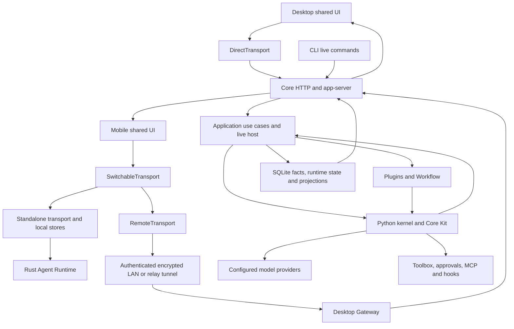

# Sunday architecture assessment — Architecture task 0

Review date: 2026-10-13. Baseline: working tree based on `f046409ac5e43b2403ea261407204330e77bc458`, desktop version 0.3.18. Existing uncommitted runtime, model, update, test, and release changes are included where inspected. References describe this working tree, not a clean release. No product code was modified.

## Assessment

Sunday is a local-first modular monolith with a shared Vue workbench, a Python workspace host and Agent Runtime, a Tauri desktop process host, encrypted remote access, and an additional Rust/mobile standalone execution stack. It has useful abstractions already: RuntimeKit, model and state ports, transport injection, an operation catalog, transactional event/projection persistence, and explicit Workflow execution adapters.

Its principal architectural debt is **ownership convergence and duplicated semantics**, rather than an inherently wrong deployment model. Application assembly also contains use cases and model infrastructure; extensions can depend on arbitrary host internals; standalone mobile reproduces server-facing state and execution behavior. These pressures make changes cross module and language boundaries even when the intended feature is local.

Preserve the local-first deployment and existing useful ports. Restructure responsibility where coupling is demonstrated. Do not introduce microservices, an abstract universal framework, or a wholesale persistence replacement as the default response. No P0 defect was established by this review. P1 below means high architectural value or material correctness risk under a concrete trigger, not a demonstrated production outage.

## Scope and evidence

Six bounded code reviews covered runtime, UI, extensions, persistence, infrastructure, and shared services. The main review checked assembly, operation/config routing, event publication, transactions, recovery, existing architecture documents, and selected tests. Archived member products were excluded as inactive; the website was considered as a distribution/shared-UI consumer.

This is a source-based assessment, not exhaustive certification of every function or a load/security audit. Existing diagrams and historical reviews were context, not proof of current behavior. No browser, Computer Use, visual acceptance, installer, or public-deployment checks were performed.

## Subsystems and ownership

| Subsystem | Responsibility | Dependencies and communication boundary |
|---|---|---|
| Shared UI / Workbench | User intent, navigation, client state, event/snapshot projection and rendering | Injected `LamToolsTransport` and platform capabilities; JSON-RPC, HTTP, events. Does not directly call Python kernel. |
| Desktop host | Native window/capabilities, backend process lifecycle, API address, remote gateway | Tauri Rust starts Python or packaged LamCore; Vue receives DirectTransport. Gateway operates outside Vue. |
| Mobile host | Native device capabilities, local/remote selection, pairing and standalone execution integration | SwitchableTransport selects standalone or remote transport; standalone invokes embedded Rust execution and local stores. |
| Remote infrastructure | Authenticated encrypted access to a desktop workspace | Gateway bridges tunnel requests to Core; Relay forwards encrypted frames rather than owning conversation models. |
| App-server / HTTP / CLI | Protocol decoding, connection management and external entry points | Routes into live operation host and operation catalogs; CLI includes both live-host and direct local paths. |
| Application services | Turn acceptance, session/project operations, approvals, queues, recovery, composition and lifecycle | Assemble kernel, plugins, persistence and schedulers. This is the most crowded ownership boundary. |
| Agent Runtime | Model/tool loop, context/request hooks, verification, decisions, continuation and cancellation | Kernel consumes RuntimeKit, model, tools, state/checkpoint and event interfaces; CoreBaseAgentKit supplies product policy. |
| Model services | Model/provider selection, request adaptation, streaming and retry | JSONC model/provider configuration and HTTP clients; equivalent provider/runtime work also exists in Rust. |
| Tools / extensions | Built-in tools, plugin contributions, MCP, hooks and skills | Toolbox permission gate; Python plugins are trusted in-process code; MCP uses separate client/process lifecycle; skills are prompt resources. |
| Workflow | Versioned graph document, compilation, node execution, durable runs/retries/waits/signals/cache | Plugin-owned engine, host Agent/Model invokers, durable SQLite claims and flow-control leases; Arrange supplies activation scheduling. |
| Persistence | Runtime continuation state, event journal, snapshots, projects, goals, schedules and content metadata | SQLAlchemy/SQLite repositories and a write coordinator; files hold user configuration, memory and content. Mobile has separate local persistence. |
| Shared services | Memory, attachment/artifact management, export, network routing, power/memory guards and updates | Called by tools and use cases; several concrete repositories depend on ORM models located under `app`. |

Key entry references: [runtime injection](../../../ui/src/app/runtime.ts#L51), [Workbench](../../../ui/src/workbench/createWorkbench.ts#L84), [desktop bootstrap](../../../desktop/src/main.ts#L160), [mobile bootstrap](../../../mobile/src/App.vue#L214), [HTTP assembly](../../../src/lamtools_core/app/http_agent_app.py#L203), [operation catalog](../../../src/lamtools_core/app/operation_catalog.py#L38), [kernel contract](../../../src/lamtools_core/kernel/kit.py#L14), [database assembly](../../../src/lamtools_core/app/core_db.py#L1850).

The return arrows represent events and read models, not dependency inversion. CLI also has direct local/configuration commands outside the diagram's live-host flow.

## Principal data flows

**Agent turn.** A client submits intent through transport; live/application services materialize thread/turn context and acceptance events. Runtime assembly resolves model, tools, permissions and persistence. Kernel calls Kit context/request hooks, streams the model, parses tools, executes, verifies and decides. Runtime state/checkpoints support continuation; application events and snapshots support clients and durable history. This is coordinated mutable execution plus a journal and read models, not strict event sourcing. See [acceptance plan](../../../src/lamtools_core/app/turn_acceptance.py#L41), [kernel execution](../../../src/lamtools_core/kernel/loop.py#L783), [Kit policy](../../../src/lamtools_core/app/base_agent.py#L807).

**Approval and continuation.** Toolbox gating can pause execution; server requests expose the pending interaction to clients. A response goes through live approval/application handling, not a UI-only permission decision. Runtime approval/continuation state must remain distinct from a rendered card and from terminal transcript state.

**Persistence and reconnect.** `AppPersistenceHost` appends events and projects snapshots within coordinated transactions/savepoints. Streaming may defer projection until a turn boundary. Clients consume live deltas and later reconcile snapshots/replay cursors. The event hub uses bounded queues and reports a gap on per-thread overflow. Recovery closes recorded terminal turns and stale active turns under explicit policies. See [persistence host](../../../src/lamtools_core/app/persistence_host.py#L139), [write coordinator](../../../src/lamtools_core/app/sqlite_write.py#L154), [event hub](../../../src/lamtools_core/app/live_hub.py#L38).

**Delegation and Workflow.** Subagents reuse the Python kernel/Kit with agent identity, shared persistence and scoped execution context. Workflow compiles versioned definitions, invokes Agent/Model adapters, and records run/node/attempt outcomes. Durable claims have renewal and fencing; Workflow is not merely an in-memory graph loop. See [subagent runner](../../../src/lamtools_core/tool/sub_agent_runner.py#L503), [Workflow adapters](../../../src/lamtools_core/plugins/bundled/workflow/backend/runtime.py#L1260), [durable claims](../../../src/lamtools_core/plugins/bundled/workflow/backend/runtime.py#L1646).

**Extensions.** Root discovery → manifest validation → enablement → trusted backend lifecycle and contributions → operation/tool catalogs → permission-controlled invocation. MCP and hook execution have their own lifecycle/trust checks. Declarative widgets provide a narrower UI boundary than arbitrary plugin backend code.

**Standalone mobile.** Shared UI remains the same, but local transport emulates host operations, snapshots, config and runtime coordination using local repositories and embedded execution. Remote mobile instead consumes the desktop workspace host. These are different execution authorities behind one transport interface, not one runtime implementation.

## Prioritized findings and recommendations

### P1 — Make Workflow queue durability truthful and ownership transactional

**Evidence.** Queue state/history lives in a whole-file JSON store, loaded once per instance. Save/delete/clear mutate memory and swallow `OSError`, then return the item/success/count ([queue.py:236](../../../src/lamtools_core/plugins/bundled/workflow/backend/queue.py#L236), [298](../../../src/lamtools_core/plugins/bundled/workflow/backend/queue.py#L298)). Each instance has only its own asyncio lock. Queued-to-running uses a read followed by save ([732](../../../src/lamtools_core/plugins/bundled/workflow/backend/queue.py#L732)).

**Consequence.** Disk-full or permission failures can acknowledge accepted work or cancellation without durable persistence. A temporary-directory fault probe confirmed that save returns success and the in-memory item exists, while a fresh store has no item. Multiple processes/instances can overwrite queue records even though durable runner claims reduce duplicate execution of the same run.

**Recommendation.** First make persistence failures explicit and preserve consistent memory/disk state. Then move queue transitions/claims into a transactional repository with compare-and-set semantics, preferably reusing existing SQLite infrastructure. Atomic rename is useful but does not fix acknowledgement or ownership. Treat file JSON as an import/export format if no longer needed for active queue storage.

**Acceptance.** Disk failure cannot return durable success; two workers cannot lose each other's queue edits; restart reconciles the same pinned run identity. Keep delivery semantics explicit: claims fence claim ownership, while external node effects require executor idempotency. Do not promise exactly-once side effects from a lease alone ([runtime.py:1646](../../../src/lamtools_core/plugins/bundled/workflow/backend/runtime.py#L1646), [3282](../../../src/lamtools_core/plugins/bundled/workflow/backend/runtime.py#L3282)).

### P1 — Apply pairing admission controls to every code-checking endpoint

**Evidence.** Gateway defaults to an all-interface bind ([gateway.rs:36](../../../desktop/src-tauri/src/remote/gateway.rs#L36)). HTTP handles `/_lamtools/pairing/resolve` before rejecting non-loopback plaintext access ([427](../../../desktop/src-tauri/src/remote/gateway.rs#L427)). Resolver checks a six-digit code without consuming the five-attempt limit that redemption enforces ([pairing.rs:14](../../../desktop/src-tauri/src/remote/pairing.rs#L14), [203](../../../desktop/src-tauri/src/remote/pairing.rs#L203), [235](../../../desktop/src-tauri/src/remote/pairing.rs#L235)).

**Trigger/consequence.** During an active pairing window, a network peer can test guesses at the resolver without redemption's lockout. A hit reveals pairing metadata; subsequent redemption can use the discovered code. Noise protects the ensuing channel but does not eliminate guessing at its bootstrap authorization boundary. No attack or practical sweep throughput was tested.

**Recommendation.** Enforce bounded guessing and connection/request admission at resolve as well as redemption; retain expiry and one-time consumption. Consider a stronger bootstrap secret for QR/full-link pairing. Specify the LAN threat model and protect global resources: the gateway uses per-connection threads and large per-message caps ([gateway.rs:347](../../../desktop/src-tauri/src/remote/gateway.rs#L347), [763](../../../desktop/src-tauri/src/remote/gateway.rs#L763)).

**Acceptance.** Resolver guessing is bounded across concurrent connections; valid pairing still works; an unauthenticated peer cannot exhaust unbounded connection/message resources. Review managed relay configuration separately: open registration is the default ([control.rs:274](../../../remote/relay/src/control.rs#L274)); remote HTTP relay configuration allows plaintext control credentials ([relay.rs:58](../../../desktop/src-tauri/src/remote/relay.rs#L58)). These are deployment policy concerns, not proof of exposure in the user's live deployment.

### P1 — Establish a single application boundary independent of entry points

**Evidence.** HTTP assembly imports `CoreHttpLLMClient`, configuration resolution and private path helpers from CLI ([http_agent_app.py:20](../../../src/lamtools_core/app/http_agent_app.py#L20)). CLI owns model HTTP implementation ([cli.py:375](../../../src/lamtools_core/cli.py#L375)) and process-wide model-store/project context ([cli.py:105](../../../src/lamtools_core/cli.py#L105)). HTTP assembly combines startup, recovery, schedulers, plugin lifecycle, routes and multiple domain operation builders ([http_agent_app.py:351](../../../src/lamtools_core/app/http_agent_app.py#L351), [977](../../../src/lamtools_core/app/http_agent_app.py#L977), [1524](../../../src/lamtools_core/app/http_agent_app.py#L1524)).

**Consequence.** Transport code is a dependency of model/application behavior. Two independently configured hosts in one interpreter can overwrite shared model scope; tests require global-context management. Entry points can diverge because mutations are implemented in several places: direct CLI model writes ([cli.py:4842](../../../src/lamtools_core/cli.py#L4842)), HTTP model operations and the config operation catalog.

**Recommendation.** Move model resolution/client construction into model/config services with explicit scoped inputs. Give application use cases one owner and have CLI/HTTP/RPC translate inputs into those use cases. Keep composition centralized, but move use-case execution out of composition. Do not preserve CLI imports as an architectural contract.

**Acceptance.** Two hosts with different model/project roots can coexist without cross-routing; equivalent CLI/RPC mutations share validation and side effects; model services import no CLI or HTTP entry point.

### P1 — Define an explicit execution and protocol parity strategy for mobile

**Evidence.** Desktop launches the Python backend ([main.rs:1772](../../../desktop/src-tauri/src/main.rs#L1772)). Rust contains another agent loop, policy constants, providers, tools, Study and Workflow modules ([runtime-rs/lib.rs:1](../../../runtime-rs/src/lib.rs#L1)). Mobile `StandaloneTransport` owns repository/config/embedded engine/extension/Study/Workflow/persistence/snapshot coordination ([StandaloneTransport.ts:287](../../../mobile/src/standalone/StandaloneTransport.ts#L287)) and constructs turn/item read models itself ([950](../../../mobile/src/standalone/StandaloneTransport.ts#L950)).

**Consequence.** Shared Vue components and transport types conceal duplicated behavior. Changes to completion, cancellation, permissions, history, retries or Workflow semantics need independent Python/Rust/TypeScript implementations. Offline mobile is a valid requirement; the resulting parity surface is still structural debt.

**Recommendation.** Document which implementation owns each behavior and the intended migration endpoint. Use common recorded command/event fixtures to verify equivalent outcomes on both runtimes. Keep standalone transport as protocol adaptation and separate its use cases/persistence coordination. Converge execution policy only where behavior genuinely must match; expose platform limitations explicitly rather than manufacturing parity.

**Acceptance.** A published capability matrix and tests cover accepted turns, cancellation, approval, failure/recovery, tool continuation and snapshot replay on both authorities. Avoid claiming complete Rust replacement from a shared crate name alone.

### P1 — Make plugin identity deterministic across roots

**Evidence.** Discovery deduplicates manifest paths, then appends every valid manifest ([registry.py:199](../../../src/lamtools_core/plugins/registry.py#L199)). Enablement/state are keyed by name ([154](../../../src/lamtools_core/plugins/registry.py#L154)); assembly iterates enabled manifests ([base_agent.py:1286](../../../src/lamtools_core/app/base_agent.py#L1286)). Default roots include user, project, Core and bundled locations ([1442](../../../src/lamtools_core/app/base_agent.py#L1442)). Tool-name collision rejection does not resolve plugin identity collisions.

**Trigger/consequence.** Two different roots containing the same plugin name can share enablement while both are assembled. Backend lifecycle, config and operation ownership become ambiguous. This is a concrete structural inconsistency; no installed collision or user incident was demonstrated.

**Recommendation.** Define stable identity and an explicit collision policy. Reject ambiguous duplicates with actionable diagnostics, or select one winner using documented override rules. Apply the selected identity consistently to lifecycle, config, permissions, operations, widgets and management.

**Acceptance.** Duplicate-name tests across all supported roots prove that only one unambiguous plugin is active and management targets exactly that plugin.

### P1 — Replace extension service escape hatches with focused host contracts

**Evidence.** `PluginContext.services` is an untyped mutable map shared across context clones ([context.py:38](../../../src/lamtools_core/plugins/context.py#L38), [77](../../../src/lamtools_core/plugins/context.py#L77)). Workflow has explicit invokers but retains concrete `llm_client`/`sub_agent_runner` bridges ([runtime.py:1260](../../../src/lamtools_core/plugins/bundled/workflow/backend/runtime.py#L1260)); operation handlers obtain a runner factory from context ([operations.py:986](../../../src/lamtools_core/plugins/bundled/workflow/backend/operations.py#L986)).

**Consequence.** Extensions couple to host wiring and internal object lifetimes. Core cannot evolve a service without discovering implicit consumers. Versioned manifests alone do not version these dependencies.

**Recommendation.** Introduce small typed contracts for capabilities actually consumed: Agent invocation, Model invocation, content references, scheduling and scoped storage. Migrate concrete bridges to adapters and then retire them where unnecessary. Do not replace the map with an equally broad universal host interface.

**Acceptance.** Workflow and representative plugins run against contract fakes without importing runtime factories or private application state.

### P2 — Strengthen protocol evolution at the decoding boundary

**Evidence.** Server initialization returns `protocolVersion` ([live_router.py:929](../../../src/lamtools_core/app/live_router.py#L929)). Shared client waits for initialize but does not use its returned version ([client.ts:94](../../../ui/src/appServer/client.ts#L94)); incoming snapshots/events are largely TypeScript casts ([195](../../../ui/src/appServer/client.ts#L195), [228](../../../ui/src/appServer/client.ts#L228)).

**Consequence.** Unknown/malformed payloads or desktop/mobile version skew can fail inside projection code rather than at a clear compatibility boundary. This is a hardening/maintainability gap, not a demonstrated exploit or proof that the transport lacks security.

**Recommendation.** Validate the small set of envelope/snapshot/server-request boundaries, check supported protocol versions, and define feature capability negotiation. Share protocol fixtures across Python, TypeScript and Rust; generate DTOs where it reduces measured duplication.

**Acceptance.** Unsupported versions and malformed payloads fail clearly; supported older fixtures replay correctly. Keep projection code focused on rendering state.

### P2 — Separate persistence adapters and reduce concentrated policy ownership

**Evidence.** Concrete content repositories import ORM models from `app.core_db` ([attachment/store.py:10](../../../src/lamtools_core/attachment/store.py#L10), [artifact/store.py:25](../../../src/lamtools_core/artifact/store.py#L25), [export/service.py:14](../../../src/lamtools_core/export/service.py#L14)). Kernel, Core Kit and default assembly have large, distinct but heavily concentrated responsibilities ([loop.py:494](../../../src/lamtools_core/kernel/loop.py#L494), [base_agent.py:310](../../../src/lamtools_core/app/base_agent.py#L310), [default_agent.py:2012](../../../src/lamtools_core/app/default_agent.py#L2012)).

**Consequence.** ORM ownership appears to be application ownership, and schema changes reach unrelated service adapters. Loop/assembly changes require understanding checkpointing, compaction, events, cancellation and plugin lifecycle together. File length is supporting evidence, not the defect itself.

**Recommendation.** Move concrete SQLAlchemy models/adapters to a persistence boundary while leaving domain ports with their consumers. Extract cohesive lifecycle and execution-policy collaborators when changing those concerns. Preserve the readable phase order of the kernel; do not fragment it into arbitrary tiny modules.

**Acceptance.** Runtime/model contracts do not import entry points or ORM models; content services can be tested independently; composition is explicit and shutdown ownership remains clear.

### P2 — Finish the artifact registry transition and bound content before buffering

**Evidence.** SQLite ArtifactStore imports legacy manifests once per project ([artifact/store.py:51](../../../src/lamtools_core/artifact/store.py#L51)); image generation still receives a filesystem ArtifactRegistry ([default_agent.py:2930](../../../src/lamtools_core/app/default_agent.py#L2930)), and HTTP reads retain fallback resolution ([http_agent_app.py:905](../../../src/lamtools_core/app/http_agent_app.py#L905)). Upload routes check size when metadata is present, then read the full file before the authoritative service byte check ([836](../../../src/lamtools_core/app/http_agent_app.py#L836), [attachment/service.py:54](../../../src/lamtools_core/attachment/service.py#L54)).

**Consequence.** Two artifact registration paths make ownership/migration completion unclear, especially after the one-time import marker. New generated manifests need a reliable path into the canonical library. Large uploads with unavailable size metadata can allocate before rejection. Neither a missing artifact nor an oversized-upload incident was reproduced.

**Recommendation.** Route new registrations through one artifact service/repository; retain legacy reading only as an explicit migration adapter with an exit criterion. Use bounded streaming reads before allocation and preserve the service's validation. Export already has a shared service and does not justify another rewrite.

**Acceptance.** Newly generated artifacts remain visible after legacy import has completed; library reads and tool writes agree on identity; unknown-size uploads stop at the configured limit before whole-file buffering.

## Acceptable trade-offs and limits

- **One Python workspace host and SQLite:** appropriate for a local-first desktop product. WAL, coordinated writes, revisions and session serialization are meaningful controls. A write bottleneck is a scaling ceiling, not justification to deploy a database server today.
- **Events plus mutable state plus snapshots:** valid when each has a clear owner. Runtime state supports continuation; events record facts; snapshots serve reads; UI projections are caches. The existence of several stores alone does not prove incorrectness. Recovery and projection-lag contracts matter more than a claim of one universal source of truth.
- **Bounded live queues:** per-thread overflow produces a gap/reconnect path ([live_hub.py:46](../../../src/lamtools_core/app/live_hub.py#L46)); global broadcast is best-effort ([62](../../../src/lamtools_core/app/live_hub.py#L62)). Suitable for refresh notifications; durable critical transitions must not depend solely on global broadcast.
- **Trusted in-process plugin code:** deliberate install/enable trust ([base_agent.py:1331](../../../src/lamtools_core/app/base_agent.py#L1331), [lifecycle.py:61](../../../src/lamtools_core/plugins/lifecycle.py#L61)). Tool approval is not backend sandboxing. Shared interpreter dependencies create upgrade coupling. Process isolation becomes warranted if the product intends to run untrusted extensions, not simply because plugins exist.
- **JSONC configuration versus SQLite runtime data:** coherent separation of user-editable settings from operational data. Atomic file replacement prevents truncation ([config/root.py:62](../../../src/lamtools_core/config/root.py#L62)); it does not by itself provide multi-record transactional consistency or prevent lost updates.
- **UI projection layers:** event coalescing, cached identities and history windowing are justified performance work, not duplication to delete mechanically. Keep execution/permission decisions on the host.
- **Large histories:** turn-count paging is not a byte budget. Mobile's broad import request is an already recorded product decision ([App.vue:588](../../../mobile/src/App.vue#L588)); see the authoritative [streaming performance record](../../../../docs/core-ui-streaming-perf.md). Measure memory/latency and choose byte-oriented limits or segmented transfer before claiming scalability.

## Recommended sequence

1. Correct Workflow durability acknowledgement and pairing admission controls; verify failure/concurrency behavior.
2. Specify application/state ownership, runtime parity and plugin identity contracts; add meaningful boundary fixtures.
3. Remove CLI-owned model infrastructure and shared host configuration globals; consolidate mutation use cases. Resolve plugin identity collisions.
4. Migrate Workflow/extension host access to focused contracts; split standalone host orchestration and enforce Python/Rust/protocol conformance.
5. Finish artifact write ownership, improve protocol decoding and move ORM/adapters to a clear persistence boundary. Extract concentrated services incrementally around real feature work.

Do not combine these into a repository-wide rewrite. For each change, use concrete acceptance above, preserve terminal/recovery semantics, and remove unnecessary compatibility bridges once consumers are migrated.

## Verification performed

Code-level tests: `test_app_persistence_host.py`, `test_core_live_hub.py`, `test_sqlite_write_pragmas.py` — **13 passed**; `test_core_live_recovery.py` — **7 passed**, with 21 existing sqlite datetime-adapter deprecation warnings. These checks support the inspected transaction/gap/recovery behavior; they do not certify the entire architecture or distributed/runtime parity.

An isolated temporary-directory probe injected a queue write `OSError`: save returned success, the live store contained the item, and a new store contained no item. No real user queue/data was used. Pairing and other findings were established from source inspection, without live exploitation.

No refactoring, deployment, installer or visual acceptance was performed. Only review documentation is added.

## Documentation freshness

The prior review is pinned to a different revision and remains historical evidence. At intake, `agent_docs/project_core_tech.md` described Workflow single-flight as process-local only and the overview described its queue as SQLite-backed; current runner claims and JSON queue contradict those descriptions. Overview/core-tech update descriptions also predated the implemented website-manifest download/install path. Those focused descriptions are corrected and the overview links this assessment. Historical review documents remain unchanged.
