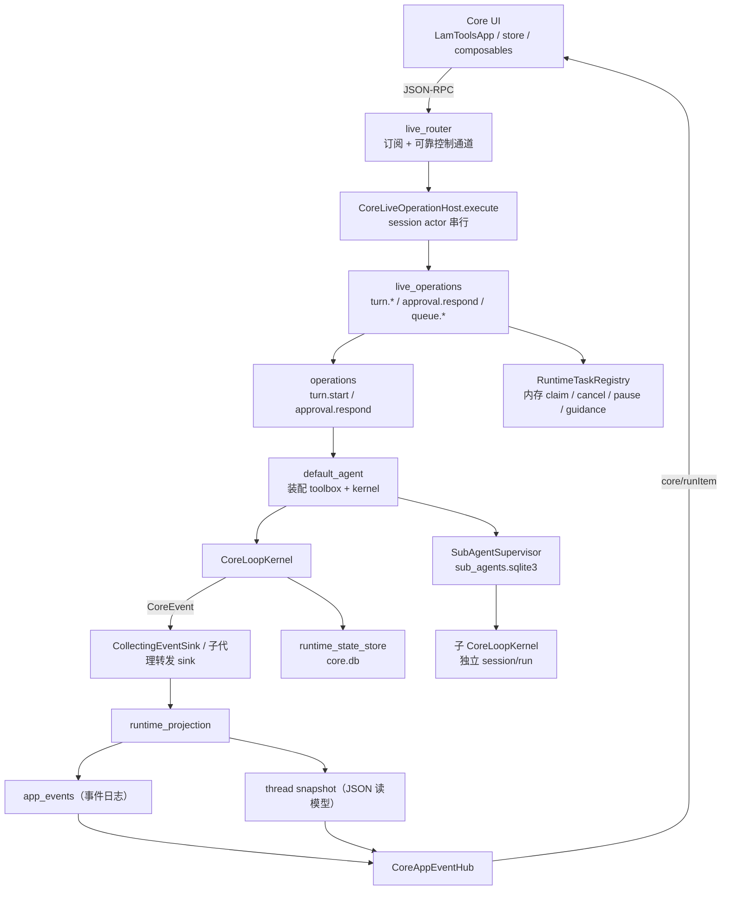
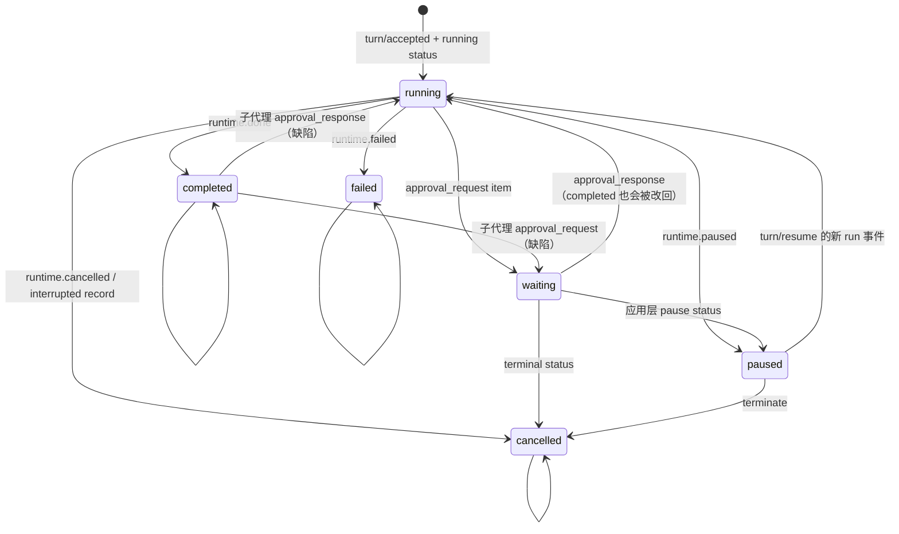
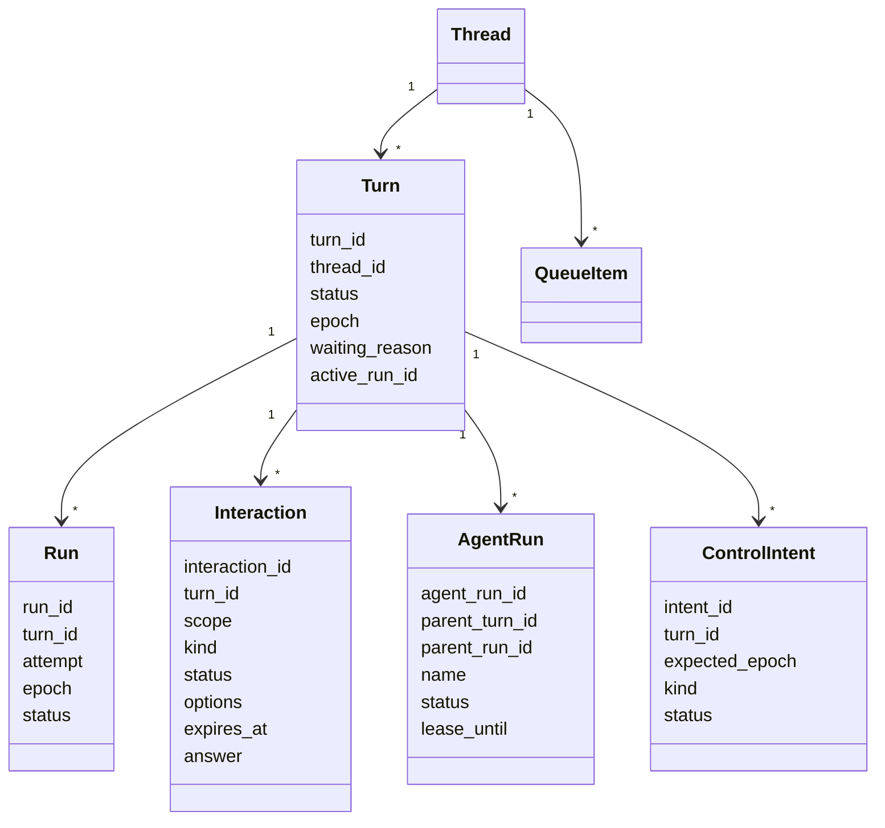
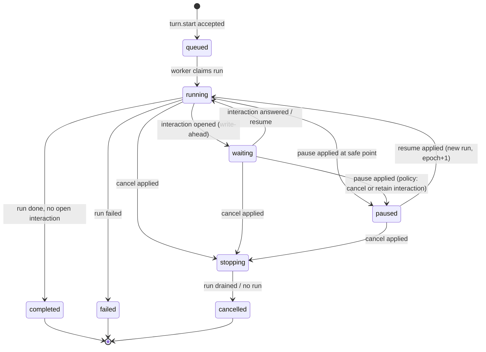
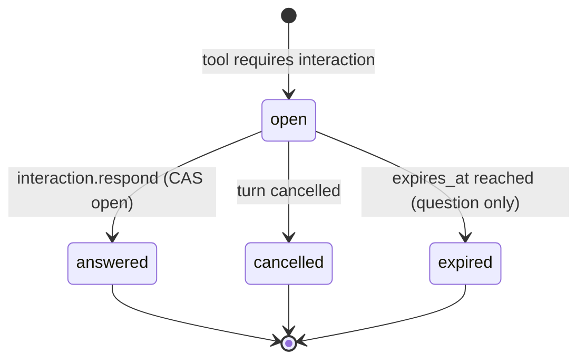

# 回合控制与交互链路：架构审查与重设计

> 复核说明（2026-10-22）：下方实施记录保留为历史；“完成（镜像）”不代表唯一写入权已接管。最近真实暂停事故仍出现 runtime paused、原回合 running、假回合 cancelled。当前架构结论、127 项边界目录和迁移完成门槛以 [第二轮重设计](turn-control-redesign-2026-10-22.md) 为准，不能依据本文旧测试总数宣称问题已解决。

> 状态：审查 + 实施记录。代码已按本文主体实施；定向测试已通过（535 passed），未运行全量测试（用户要求）。
> 审查基线：当前工作树（分支 `codex/multiplatform-dev`，HEAD `701cf2db`）。
> 范围：暂停 / 恢复 / 中断；审批；问询；子代理，以及它们共享的回合状态、事件投影与前端动作态。

---

## 0. 实施状态（2026-10-21）

### 0.1 已落地

| 工作流 | 状态 | 落地内容 |
| --- | --- | --- |
| W1 领域底座 | 完成 | `turn/model.py`、`turn/store.py`、6 张 SQL 读模型表、迁移回填 `turn/migrate.py` |
| W2 投影收口 | 完成 | 子代理作用域保护、终态/暂停行身份统一、审批决策走 hub、响应触发快照、`source_*`/`parent_*` 别名 |
| W3 内核边界 | 完成 | 同批串行化（普通调用先执行、后续审批显式延期）、复合 `request_id`、问题选项稳定 ID、`context`、`skip`、consider 模式 question |
| W4 回合控制 | 完成（镜像） | `turn/coordinator.py`（转换表、每回合锁、epoch、控制意图）已接入 live 层镜像；旧写入路径仍保留 |
| W5 续跑 | 完成 | 审批/提问续跑写入 `core_turn_jobs`，由 `TurnWorker` 单主认领执行；RPC 在持久认领后返回 accepted；租约过期回收、启动 `requeue_running_jobs`、恢复器跳过仍有待续跑任务的回合 |
| W6 交互 | 完成 | interaction 镜像、`interaction.list/respond`、后端自动跳过、能力位；快照暴露 open interactions；前端可按 interaction id 作答 |
| W7 子代理 | 完成 | 会话锁、租约、runner 配置热刷新、终止含暂停成员、close/delete 内联取消、记录同步、supervisor/并发上限、删除标记；所有持久记录镜像到 `core_agent_runs`，启动时 `sync_agent_runs` 重建并隐藏失去 sqlite 记录的旧行 |
| W8 前端 | 完成 | `selectTurnControl`、后端接管时禁用本地计时器、暂停保留问题原文、长按/右键/焦点终止可发现性、过期卡片从服务端索引补位 |
| W9 清理 | 完成 | 删除重复定义、`paused` 类型、状态映射、移除无界缓冲、删除 `sub_session.py`、修正提示词契约、删除成员持久化隐藏；`PermissionResolver` 成为 gate 实时输入的唯一写入点，`overlay_runtime_permissions` 统一权限覆盖；`auto_approve` 预设移入 `ApprovalGate.check`，破坏性命令确认优先于预设；状态词表集中到 `turn.model` 并由旧模块别名引用 |

### 0.2 未完成项与设计冲突

| 项 | 结论 |
| --- | --- |
| 多张审批卡同时展示 | 未实现，属于设计冲突而非遗漏。当前 runtime state 只有单个 `pending_approval`，续跑是“模型收到 deferred 结果后重新发起调用”。要让同批多张卡在答完一张后回到**原批次**继续执行，需要 step-level resume（从审批门恢复同一批工具调用）；在模型驱动续跑上直接加多卡会重复或丢失工具执行。当前安全行为：同批非审批调用先执行，后续审批得到显式 deferred 结果并由模型重发，不丢调用、不重复执行。 |

---

## 0. 结论摘要

### 0.1 一句话

四条链路各自都能跑通，但它们不是同一套状态机的四个视图，而是**四套并行的状态所有权**：回合状态同时被运行状态、快照事件、内存任务注册表和子代理 SQLite 改写；"等待用户"被实现成审批的一个特例；"继续"通过复制五条不同的内核装配路径实现。当前绝大多数卡死、复活、丢卡、超时问题，都是这三个结构的直接后果。

### 0.2 五个根因

| 编号 | 根因 | 表现 |
| --- | --- | --- |
| R1 | **双身份未分层**：`turn_id`（逻辑回合）与 `run_id`（一次执行）在代码里互换使用，恢复后 `state.run_id` 变成新的 execution UUID | 重启后待审批回合被误判为不可恢复；拒绝/失败事件生成幽灵回合 |
| R2 | **多写者、无单一权威**：runtime state、event log/snapshot、`RuntimeTaskRegistry`、`sub_agents.sqlite3` 各自写状态，没有事务边界 | 暂停与内核收尾互相覆盖；恢复后子代理仍在跑；force reset 与 pause 竞争 |
| R3 | **等待被建模为审批特例**：`pending_approval` 既存审批也存提问，问题在线上仍是 `request_kind:"permission"`，决策动词 `deny` 又被复用为"跳过" | 问询与审批语义纠缠；批处理中第二张卡丢失；选项标签被当成 ID |
| R4 | **续跑是复制出来的**：审批、拒绝、引导、回答问题、子代理交回各自重建 kernel，装配参数和生命周期钩子不同 | 续跑期间暂停/取消/引导失效；RPC 等待模型跑完；子代理恢复绕开写锁 |
| R5 | **投影把条目状态和回合状态混在一起**：`kind="approval_request"` 可直接把任意 turn 改成 `waiting`，`approval_response` 可把 `completed` 改回 `running` | 子代理在父回合结束后提问，父回合永久复活并阻塞新消息 |

### 0.3 六项重设计决策

1. **单一回合权威**：引入 `TurnCoordinator`，只有它可以写回合状态；其他模块通过持久化控制意图请求变更。
2. **逻辑回合 / 执行尝试分层**：`Turn` 稳定不变，`Run` 每次续跑新建；所有事件与写入携带 `(turn_id, run_id, epoch)`。
3. **一等交互实体**：审批、提问、澄清统一为 `Interaction`，服务端生成全局唯一 ID，拥有独立状态机与过期策略。
4. **单一续跑管线**：所有"继续"都是 `ContinuationJob`，由后台 TurnWorker 消费，RPC 只做持久化接收，不再内联跑模型。
5. **作用域化事件**：事件显式携带 `scope`（`main` / `agent:<run>`），只有 `turn.lifecycle` 事实能改回合状态。
6. **前端只做投影**：动作态、待决策列表、自动继续倒计时全部由服务端事实派生；删除渲染进程内的领域计时器与工具名正则分类。

### 0.4 最高风险缺陷（P0）

| ID | 结论 | 直接后果 |
| --- | --- | --- |
| TC-01 | 恢复后 `state.run_id != turn_id`，`_active_turn_awaits_user_decision` 比较失败 | 重启后待回答的审批/提问被启动收割机取消 |
| AP-01 | 提问的跳过/拒绝在 `approval.respond` 的会话串行锁内跑完整续跑；审批通过后的后台续跑没有暂停/取消信号 | 跳过/拒绝阻塞同会话的暂停、终止、新消息并可触发 30s 超时；审批续跑无法停止 |
| QU-01 | 五分钟后自动继续只存在于 WebView，且只扫描当前窗口的活跃会话 | CLI、移动端、后台、切走会话、重启都不会自动继续 |
| SA-01 | 子代理审批/提问事件没有嵌套作用域保护，父回合结束后仍会把父回合改成 `waiting`/`running` | 已完成的回合永久阻塞新回合 |
| AP-02 | 一步只处理 `approval_calls[0]`，同批其他调用既不执行也不出卡 | 同批第二个问题永远不可见；同批读取被丢弃并伪造成"中断" |
| EV-01 | 拒绝子代理审批时发出的终态事件没有 `turn_id`，投影按 `run_id` 编造父回合 | 产生永不结束的幽灵回合 / 真实回合卡在 `waiting` |

---

## 1. 审查方法

静态逐段阅读以下文件（括号内为主要关注点）：

- 内核与工具边界：`kernel/loop.py`（等待门、取消/暂停、终态事件、历史修复）、`tool/default_toolbox.py`（`prepare_call` / `prepare_approved_call` / question 规格）、`tool/approval.py`、`tool/approval_continuation.py`。
- 应用编排：`app/live_operations.py`（turn.start/resume/pause/cancel/terminate/force_reset/steer/approval.respond/恢复）、`app/default_agent.py`（审批续跑、子代理续跑、内核装配）、`app/approval_resolution.py`、`app/turn_acceptance.py`、`app/queue_state.py`。
- 状态与事件：`runtime/__init__.py`（`RuntimeTaskRegistry`、`RuntimeState`）、`runtime_owner.py`、`snapshot/__init__.py`、`event/runtime_projection.py`、`app/snapshot_store.py`、`app/core_db.py`。
- 子代理：`sub_agent.py`、`sub_agent_supervisor.py`、`tool/sub_agent_runner.py`、`app/sub_agent_recovery.py`、`app/memory_resume_supervisor.py`。
- 前端：`appServer/store.ts`、`selectors.ts`、`pendingDecisions.ts`、`workbenchActions.ts`、`workbenchProjection.ts`、`composables/useCoreLiveComposerController.ts`、`useCoreLiveTurnController.ts`、`useCoreApprovalController.ts`、`useCoreAskAutoContinue.ts`、`agents/subAgentProjection.ts`、`app/LamToolsApp.vue`。
- 现有测试：`core/tests/test_same_turn_resume.py`、`test_pause_parked_turn.py`、`test_core_live_approval_survival.py`、`test_sub_agent_*`、`core/ui/tests/core-ask-auto-continue.test.ts`、`pending-decisions.test.ts`。

只做静态推理，未启动服务、未运行测试。行号以当前工作树为准。

---

## 2. 现状全景

### 2.1 分层



### 2.2 五套状态载体

| 载体 | 位置 | 内容 | 谁写 | 生命周期 |
| --- | --- | --- | --- | --- |
| Runtime state | `core.db` 的 runtime session 行 | `status`、`loop_state`、`run_id`、`metadata.pending_approval`、`pause_reason`、history | 内核、`_settle_paused_runtime_state`、`_persist_cancelled_runtime_state`、`ApprovalResolutionLifecycle`、子代理 runner | 跨重启 |
| Event log | `app_events` | `turn/accepted`、`turn/interrupted`、`core/runItem` 等 | live 层、内核 sink、审批生命周期 | 跨重启、不可变 |
| Snapshot | `thread_snapshots` JSON | `turns`、`items`、`requests`、`queue`、`status` | 事件 reducer | 跨重启、可重建 |
| Task registry | 进程内存 | `run_id`、task、cancel/pause event、guidance 队列 | `live_operations`、`_run_core_turn`、`default_agent` | 进程内 |
| Sub-agent DB | `data_dir/sub_agents.sqlite3` | 成员记录、mailbox、outbox | `SubAgentSupervisor` | 跨重启 |

这五套载体没有共同事务。当前代码用"最后写入者 + 幂等键 + 启动收割"来弥补，但没有定义**哪一套是权威**。典型例子：内核的 detached pause finalizer 与应用层 `_settle_paused_runtime_state` 都会写 `paused`，代码注释明确承认这是"两个写者的竞争"（`kernel/loop.py:2038-2052`）。

### 2.3 四类链路的入口

| 链路 | RPC | 主要实现 | 终态出口 |
| --- | --- | --- | --- |
| 发送 / 恢复 | `turn.start` / `turn.resume` | `handle_turn_start_operation`、`handle_turn_resume_operation` | `_run_core_turn` → kernel |
| 暂停 | `turn.pause` | `handle_turn_pause_operation` → `_turn_pause_finalizer` | 内核 `runtime.paused` 或应用层 paused status item |
| 中断 | `turn.cancel` / `turn.terminate` | 同一个 `handle_turn_cancel_operation` | `_persist_cancelled_terminal` / 内核 `runtime.cancelled` |
| 审批 / 提问 | `approval.respond` | `handle_approval_respond_operation` → `default_agent.approval_respond` | 新 kernel 的 `runtime.done/failed` 或旧 run 终止 |
| 子代理 | `sub_agent` / `sub_agent_message` / `subagent.resume` | `SubAgentSupervisor` + `KernelSubAgentRunner` | 成员事件 / member-wake 新回合 |

### 2.4 状态词表（当前）

| 域 | 取值 | 定义位置 |
| --- | --- | --- |
| RuntimeState.status | `idle`、`running`、`waiting`、`completed`、`failed`、`cancelled`，实际还会写 `paused` | `runtime/__init__.py:29`（Literal 不含 paused） |
| RuntimeState.loop_state | `continue`、`wait`、`done`、`failed`，实际还会写 `paused` | `runtime/__init__.py:30` |
| Turn status（快照） | `running`、`waiting`、`interrupting`、`paused`、`completed`、`failed`、`cancelled`、`skipped` | `snapshot/__init__.py:17`、`queue_state.py:10` |
| 活跃 turn | `running`、`waiting`、`interrupting` | `queue_state.py:10`、`runtime_owner.py:26` |
| 终态 | `completed`、`failed`、`cancelled`、`skipped` | `snapshot/__init__.py:17` |
| 待决策 | `requests[*].status = open / resolved / cancelled`；事件 kind `approval_request` / `approval_response` | `snapshot/__init__.py:92-113,171-181` |
| 子代理 | `idle`、`running`、`paused`、`suspended`、`interrupted`、`closed`、`failed`，代码还检查从未写入的 `pending` | `sub_agent_supervisor.py:194-208` |
| UI 动作 | `send` / `stop` / `resume` | `useCoreLiveComposerController.ts:191-203` |

同一个概念有 5 套词表、至少 7 个定义点。新增一个状态需要同步修改内核、投影、快照、队列判定、运行时所有权、子代理和 UI。

---

## 3. 现状状态机

### 3.1 Turn（快照视角）



关键事实：

- 没有 `queued` 的写入者；`queued` 只出现在 `_latest_active_turn` 的判定里。
- `interrupting` 只由 `_append_interrupting_record` 写入；它不是终态，但也不是可恢复状态。
- `paused` 不是终态，但也不是活跃状态；它"拥有会话"的规则只写在 `handle_turn_start_operation` 的 `_paused_turn_id` 检查里（`live_operations.py:1591-1608`）。
- `waiting` 既表示"等审批/提问"，也表示"no_progress 暂停"（`kernel/loop.py:1405,1446`），两者的恢复语义不同。

### 3.2 RuntimeState（执行视角）

内核的 `_run` 会：

1. 用 `turn_input.run_id` 重置 `state.run_id`，用 `turn_input.turn_id` 写 `metadata.turn_id`（`kernel/loop.py:726-728`）。
2. 清空上一轮的 `pending_approval` / `pending_waiting_request`（`:738-745`）。
3. 在审批门把 `pending_approval.status="waiting"` 写进 metadata 并 checkpoint（`:1200-1223`）。
4. 在 `_KernelPause` / `pause_event` 时把 `status="paused"`、`loop_state="paused"`（`:1699-1713,1737-1749`）。
5. 在 `CancelledError` 时按 `_is_external_cancelled()` / `_external_pause_requested()` 选择 detached cancel 或 pause 持久化（`:508-533`）。

`turn/resume` 传入的 `run_id` 是新的 execution UUID，而 `turn_id` 保持逻辑 ID（`live_operations.py:2130,2161-2163`）。这就是 R1 的源头。

### 3.3 Interaction（当前是隐式的）

当前没有一个实体叫 Interaction。一个待决策由五处信息拼成：

| 信息 | 位置 | 键 |
| --- | --- | --- |
| `pending_approval` | runtime state metadata | `request_id = tool_call.id` |
| `pending_waiting_request` | runtime state metadata | 无 `request_id`（投影时可能编造） |
| `approval_request` item | event log / snapshot items | `item_id = thread:run:call:tool` |
| `requests[request_id]` | snapshot JSON | `request_id` |
| `decision` part / `waitingRequest` | UI 投影 | `part.id` + `request_id` |

这五处没有共同的事务，也没有共同的 ID 生成规则。`request_id` 直接复用 provider 的 tool-call id；`find_pending_approval` 在多会话中返回第一个匹配（`app/core_db.py:1013-1038`），而 `approval.respond` 在命名会话不匹配时会回退到全局查找（`app/default_agent.py:956-978`）。

### 3.4 SubAgent

成员状态与父回合状态是两套：

- 父回合 `waiting` 时，子代理可能在自己的 session 里 `paused`（等提问）、`running`、或 `suspended`（被会话暂停）。
- `_result_status` 把内核的 `decision=="wait"` 映射为记录 `paused`，把 `error=="paused"` 映射为 `suspended`（`sub_agent_supervisor.py:194-208`）。
- `interrupt_active` 只处理 `running/pending`，显式跳过 `paused`；`pause_active` 同样跳过 `paused`（`:714-782,812-876`）。
- 子代理事件经 `SubAgentEventForwardingSink` 重父级化：`session_id=父 thread`、`run_id=父 run`、`turn_id=父 turn`，真实子 run 放在 `payload.sub_agent.run_id`（`sub_agent.py:53-91`）。

### 3.5 写者矩阵

| 状态 | 写入者 |
| --- | --- |
| Turn `running` | `turn/accepted`、`running status`、任意非终态 item 的 reducer、`approval_response` reducer |
| Turn `waiting` | `approval_request` reducer、`approval_request`/`approval_response` 子代理分支、`runtime.waiting` 投影（仅非 permission） |
| Turn `paused` | 内核 `_emit_terminal_event`、应用层 `_ensure_paused_status`、`_settle_paused_runtime_state` |
| Turn `cancelled` | 内核 `_persist_external_cancellation`、`_persist_cancelled_terminal`、`_append_interrupting_record` + `_persist_cancelled_terminal`、force reset、启动收割 |
| Runtime `paused` | 内核 detached finalizer、`_settle_paused_runtime_state` |
| Runtime `cancelled` | 内核 cancel 路径、`_persist_cancelled_runtime_state`、`_reconcile_cancelled_runtime_state` |
| Runtime `waiting` | 内核审批门、`approval_resolution._restore_retryable_pending` |
| 子代理记录 | `SubAgentSupervisor`、`sub_agent_recovery` |

这张表本身就是设计结论：**没有任何一行只有一个写入者。**

---

## 4. 端到端链路（现状）

### 4.1 发送 → 运行

1. UI `startTurn` 发 `turn/start`，带 `client_message_id`；store 附上 `expected_revision`（`store.ts:868-895`）。
2. `CoreLiveOperationHost.execute` 对 `turn.start` 先查 registry 的活跃 run，有则立即 `SESSION_BUSY`（`live_operations.py:626-660`），否则进入 session actor。
3. `handle_turn_start_operation`（实际生效的是 `live_operations.py:2216` 的第二个定义）解析权限、创建工作区、写 `turn/accepted` + user item + running status，`accept_run(turn_id)`（`:2272-2340`）。
4. `_start_runtime_task` 创建 `_run_core_turn` task，注册到 registry，`run_id=turn_id`（`:4516-4569`）。
5. `member_hooks.start_runtime` → `default_agent.turn_start` → `create_kernel`；内核拿到 `cancel_event_source` / `pause_event_source` / `guidance_source`（`default_agent.py:696-725`）。
6. 内核逐 step 运行；每个事件经 sink 投影为 run item；`_persist_core_event_live` 落库并 publish。
7. 终态：内核 `runtime.done/failed/cancelled/paused` → projection → snapshot 终态；`_run_core_turn` 释放 claim，必要时补 `completed`，再派发队列（`live_operations.py:4689-4719`）。

**问题点**：第 3 步的"活跃/暂停"判定、第 5 步的装配、第 7 步的补终态，各自都有一套独立的幂等/竞争处理。

### 4.2 暂停 → 继续

1. UI 单击停止 → `pauseTurn` → `turn/pause`（`store.ts:784-794`）。
2. `handle_turn_pause_operation` 调 `registry.request_pause(force=True)`，写 `pause_reason`，派发 `_turn_pause_finalizer`，立即返回 `pausing`（`live_operations.py:2992-3040`）。
3. `request_pause` 设置 pause event 并 `task.cancel()`（`runtime/__init__.py:312-343`）。
4. 内核在流式循环中轮询 pause event，抛 `_KernelPause`；或被 `CancelledError` 捕获后走 `_spawn_external_pause_persist`（`kernel/loop.py:508-555`）。
5. 同时，`_turn_pause_finalizer` 等待 task 退出，调 `_settle_paused_runtime_state`（写 paused）、`_ensure_paused_status`（关闭未完成 item + 写 paused status）、`_pause_session_members`（`live_operations.py:3074-3103`）。
6. UI 收到 `runtime.paused` 或应用层 paused status，`resumableTurnId` 变为该 turn，按钮变 `resume`（`createWorkbench.ts:421-434`）。
7. 继续：UI `resumeTurn` → `turn/resume`；`handle_turn_resume_operation` 检查 latest turn 是 paused、无活跃 turn、state 不在 live 集合，`accept_run(turn_id)`，生成新的 `execution_id`，写 `turn/started`，启动新 kernel（`live_operations.py:2068-2213`）。
8. 新 kernel 清空 `pending_approval`，从已提交历史继续；`origin=turn_resume` 不追加合成用户消息。

**问题点**：

- 第 4/5 步是两个写者；内核的 pause 持久化是 detached task，finalizer 可能先写。
- 第 7 步的 `state.status in LIVE_RUN_STATES` 检查用 `owner_is_live`，但 `paused` 不在 `LIVE_RUN_STATES`，所以暂停的旧 run 即使还没写完也允许继续。
- 第 8 步清空 `pending_approval`，但暂停时若回合本来就在等待（没有活跃 task），`pending_approval` 不会被清，卡片却被关闭 —— 见 TC-04。

### 4.3 终止

1. UI 长按 800ms → 确认框 → `terminateActiveTurn` → `turn/terminate`。
2. `handle_turn_terminate_operation` 直接复用 `handle_turn_cancel_operation`（`live_operations.py:2974-2989`）。
3. 请求阶段先 `request_cancel(force=True)` 打断 provider/tool，然后派发 `_turn_cancel_finalizer`，立即返回 `cancelling`。
4. finalizer：写 `turn/interrupted` + `interrupting` status（幂等），等待 task 退出（最多 `CANCEL_FINALIZER_TASK_WAIT_CAP_SECONDS`），释放 claim，必要时补 cancelled 终态，最后 `_interrupt_session_members`。
5. UI 收到 `interrupting` 后按钮短暂保持 stop，终态后变 send。

**问题点**：

- `cancel` 与 `terminate` 在服务端没有区别；"不可恢复"只来自 UI 不提供 Continue。
- finalizer 是 detached；`turn/terminate` 返回时终态可能尚未落库。UI 的 `stopPending` 依赖 status 变化，期间仍可再次点击。
- `_interrupt_session_members` 只找本进程 supervisor；跨进程的成员不会被停。
- 成员提问被显式保留，与 UI"将丢弃未回答的子代理提问"文案矛盾（见 SA-08）。

### 4.4 审批

1. 模型输出 `requires_approval` 的调用；内核在 `approval_calls` 中只取**第一个**（`kernel/loop.py:1184-1190`）。
2. PermissionRequest hook 可自动批准/拒绝；否则写 `pending_approval`、checkpoint、发 `tool_call waiting` + `runtime.approval_request`，`break`（`:1200-1256`）。
3. `runtime.approval_request` 投影为 `approval_request` item，payload `type=serverRequest`，`request_id=tool_call.id`（`event/runtime_projection.py:349-376`）；snapshot 建 `requests[request_id]={status:open}` 并把 turn 置 `waiting`（`snapshot/__init__.py:171-181,206-208`）。
4. UI 从 item 构造 `decision` part，`selectPendingCoreDecisions` 扫描 assistant 消息树（`pendingDecisions.ts:100-141,329-361`）。
5. 用户点击 → `approve_once` / `approve_for_session` / `deny` / `other_guidance`（`workbenchActions.ts:270-276`）→ `approval/respond`。
6. `handle_approval_respond_operation` 在当前 session actor 内启动 `continue_approval` task，等待 `decision_ready`（决定持久化后立即返回）或整个 task 完成（`live_operations.py:3865-3897`）。
7. `default_agent.approval_respond`：
   - claim `pending_approval.status="executing"`（`default_agent.py:1045-1086`）；
   - 持久化 `runtime.approval_response`（`approval_resolution.py:47-90`）；
   - 清 pending（`clear_pending_for_execution`）；
   - 批准：内联执行工具（`prepare_approved_call` + `toolbox.execute`，`default_agent.py:1635-1664`），写工具结果，再起一个新 kernel；
   - 拒绝（非 question）：`finalize_cancelled` 终止整个回合；
   - 引导：写引导续跑 prompt，起新 kernel；
   - 提问：写答案 tool result，起新 kernel。
8. 续跑 kernel 的事件经 `CollectingEventSink` 实时落库；结束结果返回给 RPC。

**问题点**：见 AP-01 至 AP-09。

### 4.5 提问

1. 模型调用 `question`；`CoreToolbox.prepare_call` 在 mode 检查之后、权限门之前直接返回 `requires_approval=True`（`default_toolbox.py:1585-1599`）。
2. 与审批共用等待门；`_approval_request_options_and_message` 用 `args.question` 作标题、每个 option 的 **label 作为 id 和 response**；无 option 时给"确认/取消"（`kernel/loop.py:4631-4673`）。
3. 事件 payload 仍是 `request_kind="permission"`（`kernel/loop.py:4619`），因此 `runtime.waiting` 投影对它是死路径（`event/runtime_projection.py:504-507`）。
4. UI 用工具名正则 `/question|ask_clarification/i` 判定"提问"（`pendingDecisions.ts:443-445`），而不是 payload 的 kind。
5. 回答：`approval.respond` 的 `decision=approve/guide` 被当作答案文本；`deny` 被特殊化为"用户取消该问题"，写入固定中文，然后继续（`default_agent.py:1157-1163,1188-1195`）。
6. 渲染进程的 `useCoreAskAutoContinue` 在 5 分钟后以 `other_guidance` 提交"用户跳过回答"（`useCoreAskAutoContinue.ts:16-23,104-112`）。

**问题点**：见 QU-01 至 QU-07。

### 4.6 子代理

1. 主模型调 `sub_agent(action=create)`：只建记录，不跑模型（`sub_agent_supervisor.py:395-455`）。
2. `sub_agent_message` 写 mailbox 并启动 `_drive` task；`_drive` 复用 `_owned_runner`，只更新 parent sink（`:937-1000`）。
3. 子 runner 用独立 `CoreLoopKernel`，session id 为 `{parent}:sub:{name}`，事件经转发 sink 重父级化（`sub_agent_runner.py:547-716`；`sub_agent.py:53-91`）。
4. 父回合不等待子代理；父回合 `done` 后 `_announce_active_members` 发布"成员仍在运行"事实（`kernel/loop.py:1792-1800,2832-2876`）。
5. 成员完成/失败写 mailbox 与 outbox；`MemoryResumeSupervisor._wake_member_threads` 在会话空闲时启动一个新的父回合投递结果（`memory_resume_supervisor.py:247-382`）。
6. 子代理提问/审批走同一套 `approval.respond`；`default_agent` 检测 `delegated_session` + `actor_kind=sub_agent`，内联调 `resume_question`/`resume_approved`（`default_agent.py:1182-1352`）。
7. 父暂停 → `_pause_session_members` → `pause_active`；父终止 → `_interrupt_session_members` → `interrupt_active`（`live_operations.py:3255-3369`）。

**问题点**：见 SA-01 至 SA-14。

### 4.7 崩溃恢复

启动顺序（`http_agent_app`）：

1. `recover_stale_active_turns`：枚举快照中仍有活跃 turn 的会话；若 runtime state 仍是 `loop_state=="wait"` 且有 `pending_approval.status=="waiting"`，保留；否则按 state 的 `failed/cancelled` 或 `unexpected_shutdown` 关闭（`live_operations.py:5321-5423,5495-5534`）。
2. `reconcile_terminal_turns`：runtime 已终态但快照仍活跃的 turn，补终态（`:5426-5492`）。
3. `SubAgentSupervisor.recover`：把无存活 owner 的 `running` 记录改成 `interrupted`（`sub_agent_supervisor.py:341-382`）。
4. `reconcile_sub_agent_state`：修复孤儿子会话状态、补 outbox、关闭活跃子 turn（`app/sub_agent_recovery.py:39-104`）。

**问题点**：第 1 步的 `run_id` 比较错误（TC-01）；第 1 步保留的 waiting turn 没有重建缺失的审批卡（AP-03）；第 3/4 步与父回合的暂停/终止语义没有统一。

---

## 5. 缺陷清单

级别：**P0** 用户可见的死锁/数据丢失；**P1** 错误状态或可靠性问题；**P2** 一致性/可维护性；**P3** 卫生问题。

### 5.1 P0

| ID | 缺陷 | 证据 | 影响 |
| --- | --- | --- | --- |
| TC-01 | 恢复判定用 `state.run_id` 与快照 turn id 比较 | `live_operations.py:5512-5534`；resume 写入新 `execution_id`：`:2130,2161-2163` | 任何 resume 过的回合，重启后待审批/提问被取消 |
| AP-01 | 提问的跳过/拒绝在会话串行 RPC 内跑完整续跑；审批通过后的续跑虽提前返回，但后台 kernel 没有暂停/取消信号 | `live_operations.py:135-150,3865-3897`；`default_agent.py:1157-1165,1828-1861` | 跳过/拒绝可触发 30s 客户端超时并阻塞暂停/终止；审批续跑无法被用户停止 |
| AP-02 | 一步只出第一张审批卡，其余调用被丢弃 | `kernel/loop.py:1184-1256`；历史修复 `:290-362` | 同批第二问不可见；同批工具被伪造成中断 |
| QU-01 | 自动继续只在渲染进程，且只看活跃会话的窗口消息 | `useCoreAskAutoContinue.ts:16-125`；`pendingDecisions.ts` 扫描当前 messages | CLI/移动/后台/切会话/重启都不自动继续 |
| SA-01 | 子代理审批/提问会把父回合从 `completed` 改回 `waiting`/`running` | `snapshot/__init__.py:92-113,164-181,206-208` | 已完成回合永久阻塞新回合 |
| EV-01 | 拒绝子代理审批/续跑失败发出无 `turn_id` 的终态事件，投影按 `run_id` 编造父回合 | `approval_resolution.py:111-126,158-179`；`base_agent.py:1213-1216` | 幽灵回合 + 真实回合卡 waiting |

#### TC-01 细节

`recover_stale_active_turns` 最终用：

```python
run_id = str(getattr(state, "run_id", "") or "")          # live_operations.py:5514
...
return latest_active_turn_id(snapshot) == run_id          # :5534
```

普通回合 `state.run_id == turn_id`（`_start_runtime_task` 用 `run_id=turn_id`，`default_agent` 把同一值传给 kernel），所以测试通过。`turn/resume` 明确把 `run_id` 设为新的 UUID（`test_same_turn_resume.py:107` 断言 `run_id != turn_id`），于是同一回合第二次启动后，重启恢复永远不认为它在等待用户，直接走 `unexpected_shutdown` 取消。

正确判据应是 `state.metadata["turn_id"]`，并在所有比较点使用统一的 `normalize_turn_id`。

#### SA-01 细节

`apply_run_item_event_in_place` 的顺序：

1. `terminal_turn_status` 命中且 `nested_child` 为真时，**不**走提前返回（`:164`）。
2. `kind == "approval_request"`：`item["status"]="waiting"`、`state["status"]="waiting"`，随后 `_upsert_turn` 把 `turn["status"]="waiting"`（`:171-181,206-208`）。
3. `kind == "approval_response"`：turn 不是 `failed/cancelled/skipped/paused` 时一律 `running`，`completed` 不在排除列表（`:92-113`）。

而子代理事件被转发时 `turn_id=父 turn`（`sub_agent.py:85`），所以子代理在父回合结束后提问会复活父回合；`reconcile_terminal_turns` 只看 `failed/cancelled`（`live_operations.py:5266-5287`），无法修复。

### 5.2 P1

| ID | 缺陷 | 证据 | 影响 |
| --- | --- | --- | --- |
| TC-02 | 暂停/取消有三个协作机制 + 两个写者，没有单一转换权威 | `kernel/loop.py:508-576,2005-2064`；`live_operations.py:3074-3131` | 暂停后立刻继续可重叠旧 run 的 pause 写入；状态可能被覆盖 |
| TC-03 | `cancel` 与 `terminate` 服务端同义 | `live_operations.py:2974-2989` | "不可恢复"只靠 UI 不显示 Continue |
| TC-04 | 等待中的暂停不清 `pending_approval`，卡片却被关闭 | `live_operations.py:3106-3131,3149-3199`；内核仅在新 run 清理 `:738-745` | 旧客户端/自动继续仍可回答，静默复活已暂停回合 |
| TC-05 | force reset 无条件写 cancelled，可能与 pause/终端写者竞争 | `live_operations.py:3491-3592` | 修复动作本身制造新竞争 |
| AP-03 | `pending_approval` checkpoint 与卡片事件不是同一事务 | `kernel/loop.py:1223,1250-1255`；恢复逻辑 `live_operations.py:5333-5348` | 崩在中间会产生"有等待状态、没有卡"的死锁 |
| AP-04 | 决策事件持久化未传 `app_event_hub` | `default_agent.py:1108-1115,1909-1919` | 其他窗口看不到审批已解决，直到下一次快照 |
| AP-05 | `request_id` 复用 provider tool-call id，跨会话全局回退 | `app/core_db.py:1013-1038`；`default_agent.py:956-978` | 两个 `call_0` 可能把答案路由到错误会话 |
| QU-02 | 问题与审批共用 `request_kind=permission` 和 `deny` 动词 | `kernel/loop.py:4619`；`default_agent.py:1157-1163` | 选项"取消"被当成拒绝回答；语义丢失 |
| QU-03 | 选项 label 直接作为 option id | `kernel/loop.py:4644-4648` | 与 UI 的 `cancel -> deny` 映射冲突 |
| QU-04 | 问题 `context` 字段从不投影/展示 | `default_toolbox.py:751-754`；`kernel/loop.py:4638-4658` | 模型给的背景用户看不到 |
| QU-05 | 自动继续把 `running` 当作未回答，且失败后重计满 5 分钟 | `pendingDecisions.ts:231-238`；`useCoreAskAutoContinue.ts:104-119` | 重复提交/重复计时 |
| SA-02 | 子代理续跑内联且不拿 `run()` 的会话锁 | `sub_agent_runner.py:547-551` 对比 `:894,1078,1213` | 与 `sub_agent_message` 并发写同一子会话 |
| SA-03 | supervisor 冻结首个 `_owned_runner`，后续只换 parent sink | `sub_agent_supervisor.py:967-980` | 项目/权限/模型切换不生效 |
| SA-04 | pause 不等待子代理落定，Stop 等待 | `sub_agent_supervisor.py:714-803` 对比 `:812-876` | pause→resume 与旧 pause 写入竞争 |
| SA-05 | close/delete 不取消内联续跑 | `sub_agent_supervisor.py:517-540,568-579` | delete 可在 `resume_question` 写入时清库 |
| SA-06 | 没有成员租约/超时 | `sub_agent_supervisor.py:1397-1445`（无调用者） | 挂死成员永久 running |
| SA-07 | 子代理 deny/failure 不同步成员记录 | `default_agent.py:1157-1165,1399-1409` | 记录 paused 而子状态已 cancelled/failed |
| SA-08 | 终止保留成员提问，UI 却宣称丢弃；自动继续还能回答并唤醒成员 | `live_operations.py:3338-3342`；`LamToolsApp.vue:2134-2143`；`useCoreAskAutoContinue.ts:44-59` | 终止不彻底 |
| EV-02 | 任意 item 状态可把 turn 改回 running | `snapshot/__init__.py:194-198,216-224` | 迟到事件复活终态回合 |
| EV-03 | `runtime.sub_agent_status` 用 `source_call_id`，投影读 `parent_call_id` | `sub_agent_supervisor.py:1285-1297`；`event/runtime_projection.py:1098-1114` | 状态行没有父节点链接 |
| UI-01 | 动作态有四套推导（latest status / resumable / composer / sessionActivity） | `selectors.ts:88-125`；`createWorkbench.ts:421-434`；`useCoreLiveComposerController.ts:169-203`；`sessionActivity.ts` | 子代理事件后按钮状态可能互相矛盾 |
| UI-02 | 待决策客户端扫描嵌套 part；窗口外卡片不可见但服务端仍阻塞 | `pendingDecisions.ts:329-361`；10 轮窗口 | 用户看不到卡，也发不出新消息 |
| MAINT-01 | `live_operations.py` 四个函数重复定义，后者静默覆盖前 500 行 | `handle_thread_start_operation` `:1444/2023`、`handle_turn_start_operation` `:1489/2216`、`_latest_persisted_active_mode` `:1814/2541`、`_resolve_turn_approval_policy` `:1863/2590` | 维护/测试可能针对死代码 |
| MAINT-02 | `RuntimeStatus`/`RuntimeLoopState` 的 Literal 不含实际写入的 `paused` | `runtime/__init__.py:29-30`；写入点 `kernel/loop.py:1741-1749` | 类型契约失真，消费者无法穷举 |

### 5.3 P2 / P3

| ID | 缺陷 | 证据 |
| --- | --- | --- |
| TC-06 | 队列派发自成一条 turn 创建/claim 路径 | `live_operations.py:4846-4998` |
| TC-07 | 内存自动恢复与 member-wake 各自复制 turn 启动守卫 | `memory_resume_supervisor.py:275-382` |
| AP-06 | 权限在 turn.start、approval.respond、live switch、toolbox 刷新四处重新推导 | `live_operations.py:1863-1982,2590-2711,3803-3823`；`kernel/loop.py:3265-3339` |
| AP-07 | 用户已批准的调用重新 prepare 后可能 hard-block，表现为续跑失败而非新交互 | `default_toolbox.py:1635-1663` |
| AP-08 | 非提问的 `deny` 直接终止整个回合，而非返回拒绝结果让模型换路 | `approval_resolution.py:103-126` |
| QU-06 | `consider` 模式的 loadtools 白名单不含 `question` | `config/resources/loadtools.jsonc:4-18`；`default_toolbox.py:1568-1599` |
| QU-07 | 跳过回答与真实回答在历史里无法区分，续跑 prompt 仍说"用户已回答" | `approval_continuation.py:104-116` |
| SA-09 | `suspended` 在 UI 归一化中落到 `completed`，投影落到 `running` | `subAgentProjection.ts:530-541`；`runtime_projection.py:751-759` |
| SA-10 | 删除成员不清父 thread 事件日志里的子行，只做当前会话隐藏 | `sub_agent_supervisor.py:607-630`；`LamToolsApp.vue:2384-2406` |
| SA-11 | supervisor 每会话常驻，含 runner + MCP registry | `sub_agent_supervisor.py:1674-1683` |
| SA-12 | 无全局并发表；成员数量无上限 | `sub_agent_supervisor.py:236,679-681` |
| EV-04 | 终态 item_id 有 `{turn}:terminal`、`{execution}:terminal`、`{run}:paused` 等多种身份 | `turn_acceptance.py:105-123`；`live_operations.py:3201-3231`；`event/runtime_projection.py:869-877` |
| EV-05 | `seen_event_ids` 只保留 2000 条；审批响应不触发快照推送 | `snapshot/__init__.py:52-54`；`live_router.py:552-566` |
| UI-03 | 暂停用合成 cancelled tool_result 关闭卡片，问题原文从转录消失 | `live_operations.py:5053-5082` |
| UI-04 | 长按终止无可发现性，只有 hover 提示 | `CoreSendStopButton.vue:360-363` |
| UI-05 | 终止确认的丢弃清单由前端猜测数量 | `LamToolsApp.vue:2134-2143` |
| MAINT-03 | 状态词表分散在 7 处 | 见 §2.4 |
| MAINT-04 | `SubAgentEventForwardingSink._events` 累积所有 delta 且从不读取 | `sub_agent.py:43,54` |
| MAINT-05 | `sub_session.py` 是第二套子会话身份，生产未用 | `sub_session.py` |
| MAINT-06 | 提示词仍宣传已删除的阻塞式 `sub_agent(task=...)` 契约 | `base_agent.py:403-419` 对比 `default_toolbox.py:1902-1904` |

---

## 6. 根因分析

### R1 双身份

`turn_id` 是用户意图的容器，`run_id` 是一次执行。暂停/恢复天然是"同一 Turn 的多次 Run"，但当前代码在多处把两者当成同一个：

- `state.run_id` 在 resume 后是新 UUID，但仍被拿来和 turn id 比（TC-01）。
- 审批终态事件不带 `turn_id`，投影用 `run_id` 编造（EV-01）。
- 子代理的 `source_run_id` 与父 `run_id` 的命名空间不同，投影靠字符串前缀判断（EV-03）。

### R2 多写者

暂停、取消、终态、恢复各自由不同层写。代码用"幂等 event id + 覆盖式 reducer + 启动收割"来兜底，但**没有定义状态转换的单一入口**。结果是每修一个竞争就增加一个写者（`_settle_paused_runtime_state`、`_ensure_paused_status`、`_persist_cancelled_runtime_state`、`_reconcile_cancelled_runtime_state`、`recover_stale_active_turns`、`reconcile_terminal_turns`），竞争面反而扩大。

### R3 等待是审批特例

`pending_approval` 同时承担：

- 权限审批的待决记录；
- 提问的待决记录；
- 续跑所需的序列化 tool call；
- 恢复时的"可回答"判据；
- 子代理委派信息（`delegated_session`）。

一个结构承担五种语义，必然出现"拒绝即取消""选项即答案""问题也是 permission"这类重载。

### R4 续跑是复制出来的

`default_agent.approval_respond` 里至少有五条续跑分支，每条重建 toolbox、kernel、sink、MCP registry：

1. 子代理提问：`resume_question`（内联）；
2. 子代理审批：`resume_approved`（内联）；
3. 主代理提问：写 tool history + 新 kernel；
4. 批准：内联执行工具 + 新 kernel；
5. 拒绝：终态；
6. 引导：新 kernel；
7. 子代理交回：另一个 handoff kernel。

只有主 turn.start 的 kernel 拿到 `cancel_event_source` / `pause_event_source` / `guidance_source` / `checkpoint_coordinator`（`default_agent.py:696-725`）；续跑 kernel 没有（`:1828-1861`）。这不是疏忽，而是复制装配的结构性后果。

### R5 投影混淆条目与回合

`apply_run_item_event_in_place` 是一个大 `if/elif`，任何 item kind 都可能改 `state.status` / `turn.status`。注释里已经出现"只有 resume 或 status 事件可以把 paused 回合改回 running"（`snapshot/__init__.py:216-223`）这类补丁，但根本问题是**事实类型没有分层**：item 事实、turn 事实、interaction 事实混在同一个 reducer 里。

---

## 7. 重设计

### 7.1 设计原则

1. **单一权威**：每个状态只有一个写者；其他模块发出意图，不直接写。
2. **逻辑与执行分离**：Turn 稳定，Run 可多次；事件必须能区分二者。
3. **持久化意图，而非内存标志**：暂停/恢复/终止先落意图，再由协调器应用；进程崩溃后意图仍可重放。
4. **先写后做（write-ahead）**：任何"等待"在 Run 结束前先持久化交互；任何"继续"在返回 RPC 前先持久化续跑作业。
5. **作用域化事实**：父/子、主/成员的事实永不互相改写状态。
6. **RPC 只接收，不执行**：长工作全部在后台 worker；RPC 返回"已接受"和可观测 ID。
7. **前端是投影**：动作态、待决策、倒计时均由服务端事实派生；渲染进程不拥有领域计时器。

### 7.2 领域模型



字段所有权：

| 实体 | 权威写者 | 关键不变量 |
| --- | --- | --- |
| Turn | `TurnCoordinator` | 终态只能写一次；终态后不再接受任何状态变更 |
| Run | `TurnWorker` | 每个 Run 只属于一个 Turn；Run 不复活 |
| Interaction | `InteractionBroker` | `open -> answered/cancelled/expired` 单向；答案只接受一次 |
| AgentRun | `AgentSupervisor` | 一个成员名同时最多一个活跃 AgentRun；租约超时可回收 |
| ControlIntent | `TurnCoordinator` | 按 `(turn_id, epoch, seq)` 全序应用；过期意图拒绝 |
| QueueItem | `QueueDispatcher` | 每个 item 最多派发一次（幂等键） |

### 7.3 Turn 状态机（目标）



转换表（核心行）：

| From | Trigger | Guard | To | 副作用 |
| --- | --- | --- | --- | --- |
| `queued` | `run.claim` | 会话槽位空闲 | `running` | 创建 Run，发 `turn.started` |
| `running` | `interaction.open` | 交互已持久化 | `waiting` | Run 在安全点结束；发 `turn.waiting`，携带 `interaction_ids` |
| `running` | `pause.apply` | `intent.epoch == turn.epoch` | `paused` | checkpoint；结束 Run；发 `turn.paused`；`epoch+1` |
| `running` | `cancel.apply` | 同上 | `stopping` | 取消 Run；关闭全部 open interaction；发 `turn.cancelling` |
| `running` | `run.done` | 无 open interaction | `completed` | 发 `turn.completed`；释放槽位 |
| `running` | `run.fail` | — | `failed` | 发 `turn.failed`；释放槽位 |
| `waiting` | `interaction.answer` | 交互 open、答案合法 | `running` | 持久化续跑作业；创建新 Run；发 `turn.resumed` |
| `waiting` | `pause.apply` | 产品策略允许 | `paused` | **关闭或保留交互必须显式记录**；禁止留下"已暂停但仍可回答"的组合 |
| `waiting` | `cancel.apply` | — | `stopping` | 关闭交互（cancelled）；无 Run 时直接 `cancelled` |
| `paused` | `resume.apply` | 无活跃 Run | `running` | 新 Run；`epoch+1`；发 `turn.resumed` |
| `paused` | `cancel.apply` | — | `cancelled` | 发 `turn.cancelled` |
| `stopping` | `run.ended` | — | `cancelled` | 终态事件（恰好一次） |
| 任意终态 | 任何 | — | 不变 | 记录 `stale_fact` 审计，不改变状态 |

**关于"等待中的暂停"**：建议明确为二选一，并在协议里写死：

- 方案 A（推荐）：`pause` 只对 `running` 有效；`waiting` 时 UI 不显示停止按钮，用户通过交互面板回答、跳过或终止。这样不存在"暂停但卡还开着"的中间态。
- 方案 B：允许 `waiting -> paused`，同时把交互置为 `deferred`（不可回答、不可过期），恢复时重新置为 `open`。这样"暂停"是真正的冻结。

当前实现是方案 B 的半成品（卡片关闭、记录仍 open），TC-04 由此而来。重设计必须选一个，不能继续混合。

### 7.4 控制意图与 epoch

**ControlIntent** 是持久化记录，不是内存事件：

```
intent_id (ULID), turn_id, expected_epoch, kind,
payload (reason, origin, client_message_id),
status: pending | applied | rejected | superseded,
created_at, applied_at, error
```

流程：

1. RPC `turn.pause/resume/cancel` 只做参数校验与幂等查重，然后 append intent，返回 `{accepted: true, intent_id, turn_id, epoch}`。
2. `TurnCoordinator` 按 `(turn_id, epoch, seq)` 顺序应用意图；每个 Turn 一把锁。
3. 应用成功后写 `turn.lifecycle` 事实并 `epoch+1`；失败写 `intent.rejected` 和类型化原因（`not_running`、`already_paused`、`terminal`、`stale_epoch`）。
4. 所有 Run 在启动时捕获 `run_epoch`。Run 的每次状态写入都带 `run_epoch`；协调器拒绝 `run_epoch != turn.epoch` 的写入，并记录为审计事实。

这解决：

- 暂停与内核 detached finalizer 的竞争（旧 epoch 写入被拒）。
- pause→resume 的旧 run 覆盖（TC-02、SA-04）。
- force reset 与 pause 的竞争（TC-05）。
- 取消/终止的幂等（同一 intent 只应用一次）。

**为什么不用更多幂等补丁**：当前每个竞争点都靠"再检查一次 + 覆盖写"修复，但补丁之间互相不知情。epoch 是一个统一的、可证明的偏序。

### 7.5 统一交互代理（InteractionBroker）

#### 7.5.1 实体

```
Interaction:
  interaction_id      服务端 ULID（全局唯一，替代 provider call id 作为路由键）
  turn_id             所属逻辑回合
  run_id              发起它的执行
  scope               main | agent:<agent_run_id>
  kind                approval | question | clarification | plan
  status              open | answered | cancelled | expired
  tool_call_id        原始调用（仅用于展示/执行关联）
  title / body / context / facts
  options[]           {id, label, description, response}
  default_answer
  expires_at          仅 question 可设置
  claim_token         防止并发回答
  answer              {kind, option_id?, text?, skipped?}
  created_seq / resolved_seq
```

关键变化：

- `interaction_id` 与 `tool_call_id` 分离，解决 AP-05。
- `kind` 是显式字段，不再从工具名正则推断，解决 QU-02。
- `scope` 是显式字段，子代理交互不再污染父回合，解决 SA-01。
- `options[].id` 由服务端生成且稳定；`label` 只用于显示，解决 QU-03。
- `expires_at` 持久化，自动继续由后端调度，解决 QU-01。

#### 7.5.2 生命周期



- **open** 必须在 Run 结束前写入（与 checkpoint 同一事务或同一 outbox），保证不会出现"回合 waiting 但没有卡"（AP-03）。
- **respond** 使用 CAS：`UPDATE ... WHERE status='open'`；重复提交返回 `already_answered` + 原始答案，不报错。
- **cancel** 由 TurnCoordinator 在终止时统一执行，保证"终止即关闭所有未决交互"（SA-08）。
- **expire** 只对 question 生效；approval 永不自动放行（安全边界，保持现状）。

#### 7.5.3 内核边界

把"审批"从内核里拿掉，改为通用的"工具需要交互"：

```python
@dataclass
class ToolOutcome:
    status: Literal["ok", "failed", "pending"]
    result: ToolResult | None
    interaction: InteractionDraft | None
```

- 工具在执行前通过 `PermissionGate` 判断是否需要交互；需要则返回 `pending`，内核把 `InteractionDraft` 交给 broker，写 checkpoint，结束本 Run 的 `waiting` 分支。
- `question` 工具本身返回 `pending` + question draft，不再伪装成 approval。
- 一个 step 可以有多个 `pending` 调用：内核为每个调用创建交互，Run 以 `waiting_on=[interaction_id...]` 结束；所有阻塞交互解决后，续跑 Run 才继续（或按策略"首个回答到达即继续，其余取消"）。这解决 AP-02。
- 审批通过后的工具执行不发生在内核里，而发生在续跑 worker 里：worker 读到 `approved` 交互，执行工具，把 `ToolResult` 追加到历史，然后启动新 Run。内核不需要"approved call"的特殊路径。

**兼容**：第一版可以保留 `requires_approval` 字段，但把它实现为 `pending` 的一个特例；等所有工具迁移后再删除。

#### 7.5.4 问题与审批的语义分离

| 维度 | approval | question |
| --- | --- | --- |
| 决策 | `approve_once` / `approve_for_session` / `deny` / `guide` | `answer(option_id/text)` / `skip` / `cancel` |
| 超时 | 永不自动通过 | 可配置，默认 5 分钟，超时=skip |
| 副作用 | 通过后执行原工具 | 无副作用，答案写回 tool result |
| 作用域 | 主/子都可 | 主/子都可 |
| 展示 | 命令/路径/范围/原因 | 问题/背景/选项 |

`deny` 不再兼任"跳过"；`cancel` 仅表示用户取消该问题（不是取消整个回合）。问题取消后是否终止回合，由 TurnCoordinator 的显式策略决定（推荐：返回"未回答"工具结果，让模型自行决定，不终止回合）。

### 7.6 统一续跑管线

#### 7.6.1 ContinuationJob

```
job_id (ULID), turn_id, run_id, kind,
payload, idempotency_key, available_at, attempts, status
```

kind：

- `interaction_answered`
- `interaction_expired`
- `user_resume`
- `guidance`
- `tool_approval_execute`
- `member_result`
- `crash_recovery`

#### 7.6.2 流程

1. `interaction.respond` 在事务内完成：CAS 交互状态、写 `interaction.answered` 事实、写 `ContinuationJob`（幂等键 = interaction_id）、返回 `accepted`。
2. `TurnWorker`（每个会话一个串行 worker）消费 job：
   - 校验 `turn.epoch` 与 `job.expected_epoch`；
   - 把交互结果转换为历史消息（问题：tool result；审批：执行工具后 tool result）；
   - 调 `run_turn(turn, trigger)`。
3. `run_turn` 是**唯一**的内核装配入口，和 `turn.start` 共用：

```python
def build_turn_runtime(turn, run, trigger) -> Kernel:
    # 同一个函数，不分主/子、不分首跑/续跑
    return create_kernel(
        kit=...,
        cancel_event_source=registry.get_cancel_event(thread_id),
        pause_event_source=registry.get_pause_event(thread_id),
        guidance_source=...,
        checkpoint_coordinator=...,
        hook_engine=...,
        completion_gate=...,
    )
```

4. 子代理续跑不是父 RPC 的内联任务，而是 `scope=agent:<id>` 的 job，由 AgentWorker 消费；父 RPC 只负责写 job。
5. RPC 一律"接受即返回"，返回 `interaction_id` / `job_id` / `turn_id` / `epoch`；客户端通过事件观察结果。

这解决 AP-01（不再内联阻塞）、AP-04（续跑事件仍走统一 live sink）、QU-05（重复提交由 job 幂等键吸收）、SA-02（子代理续跑进 worker，拿同一把锁）。

#### 7.6.3 审批执行的一次性

审批通过后的工具执行是唯一有外部副作用的续跑。设计：

- job 进入 `executing` 前写 `tool_execution_started`（含 `interaction_id`、`idempotency_key`）。
- 执行成功写 `tool_execution_result`；失败写 `tool_execution_failed`。
- 恢复时：
  - 有 `started` 无 `result`：**不自动重跑**。把交互重新打开为 `approval_recovery`（"上次执行结果未知，是否重试/放弃"），或按工具声明的幂等性重试。这是唯一诚实的选择；当前实现会在重启后把 `pending_approval.status="executing"` 直接判为不可回答并取消，等于静默丢失。
  - 工具声明 `idempotent=True` 时允许自动重试。
- 对 `run_command` 等非幂等工具，默认走"询问用户是否重试"。

### 7.7 子代理：AgentRun

#### 7.7.1 模型

- `AgentRun` 是一次调用，`agent_name` 是逻辑槽位。同名并发调用要么排队（推荐），要么明确拒绝 `agent_busy`。
- `AgentRun` 拥有独立 checkpoint/state，但**只属于一个父 Turn**；父 Turn 结束后，AgentRun 可以继续，但它的结果只能作为 `member_result` 事件投递给父 thread，不能改父 Turn 状态。
- `AgentRun` 的交互 `scope=agent:<id>`；父回合的 `waiting` 只由主 scope 的交互触发。

#### 7.7.2 控制传播

| 父操作 | 子行为 | 说明 |
| --- | --- | --- |
| pause | `agent.pause`（`suspended_by_parent`） | 与父同一 intent/epoch；子 kernel 共享 pause token |
| resume | `agent.resume` | 从子自己的 committed history 继续 |
| cancel/terminate | `agent.cancel` | 关闭子的 open interaction；不再保留"用户的问题" |
| completed | 不自动取消 | 子继续，结果走 mailbox |
| 父新建回合 | 不自动恢复成员 | 成员恢复必须显式或由 resume 触发 |

#### 7.7.3 结果投递

- 成员完成/失败写 mailbox；`MemberWake` 只在以下条件成立时启动新父回合：
  - 无活跃 Turn；
  - 无 queued 用户消息；
  - 会话未 paused；
  - 连续 wake 未超预算。
- `member_result` 是显式 trigger；新回合的 `origin=member_wake`，不复活旧回合。
- 如果用户正在同一个会话里输入，成员结果保留在 mailbox，等下一个用户回合或显式 resume 投递。

#### 7.7.4 Supervisor 改造

- 每个会话一个 supervisor，但**每次 AgentRun 重新解析运行配置**（work_root、permissions、model、artifact store、MCP registry），不再冻结首个 runner（SA-03）。
- 每个 agent 名一把锁；`message`/`resume`/`question continuation` 都走同一把锁（SA-02）。
- close/delete 先取消该 agent 的 drive task、inline job、open interaction，再清理（SA-05）。
- 增加租约：`lease_until` 由 worker 心跳续期；超时标 `failed(lease_expired)` 并唤醒父回合（SA-06）。
- 全局并发上限 + 每会话并发上限（SA-12）。
- `delete` 发 `agent.deleted` 事实；投影隐藏子树，事件日志保留（SA-10）。

### 7.8 事件与投影

#### 7.8.1 事实类型

```
TurnFact:        turn_id, run_id, epoch, type, payload
ItemFact:        turn_id, run_id, epoch, scope, item_id, kind, status, payload
InteractionFact: turn_id, scope, interaction_id, status, payload
AgentFact:       agent_run_id, parent_turn_id, parent_run_id, type, payload
```

所有事实共享：`event_id`、`seq`、`created_at`、`schema_version`。

#### 7.8.2 reducer 规则

```python
def apply(state, fact):
    if is_turn_fact(fact):
        apply_turn_fact(state, fact)       # 唯一能改 turn.status 的分支
    elif is_interaction_fact(fact):
        apply_interaction_fact(state, fact)
    elif is_agent_fact(fact):
        apply_agent_fact(state, fact)
    else:
        apply_item_fact(state, fact)       # 只改 item；不改 turn.status
```

硬性规则：

1. 只有 `TurnFact` 能改 `turn.status` / `thread.status`。
2. `ItemFact` 只能改自己的 item，以及 `turn.last_seq`。
3. `AgentFact` 只能改 `agent_runs` 和该 agent 的 item 子树。
4. 终态后到达的任何事实：如果 `epoch` 更旧，记录 `stale_fact` 并丢弃；如果同 epoch 但试图改状态，丢弃并告警。
5. `interaction.open` 不直接改 turn 状态；由 `TurnCoordinator` 在同一事务里写 `turn.waiting` 事实。

这从结构上消灭 SA-01、EV-02 和一系列"迟到事件复活"问题。

#### 7.8.3 快照

快照保留现有 JSON 读模型，但内容改为：

```
turns: { turn_id: {status, epoch, active_run_id, waiting_reason, interactions: [...] } }
runs:  { run_id: {turn_id, attempt, status} }
interactions: { interaction_id: {...} }
agents: { agent_run_id: {...} }
items: {...}
item_order: [...]
```

`requests` 只作为兼容别名保留一个版本。

### 7.9 前端

#### 7.9.1 单一选择器

```ts
selectTurnControl(snapshot): {
  turnId, status, epoch,
  actionMode: 'send' | 'stop' | 'resume',
  canSend, canPause, canResume, canTerminate,
  pendingInteractions: InteractionView[],
  busyReason?: 'running' | 'waiting' | 'stopping' | 'paused',
  agents: AgentRunView[]
}
```

动作态规则：

| Turn 状态 | actionMode | 说明 |
| --- | --- | --- |
| `queued` / `running` / `stopping` | `stop` | 暂停或取消由按钮手势决定 |
| `waiting` | `stop`（或按 §7.3 方案 A 隐藏停止） | 决策面板是主操作 |
| `paused` | `resume` | 只有可恢复时 |
| `completed` / `failed` / `cancelled` | `send` | — |

#### 7.9.2 待决策列表

- 直接读 `snapshot.interactions`，不扫描消息树。
- 每个交互带 `item_id`，用于在转录中定位卡片；窗口外的交互仍然出现在面板里。
- 提交走 `interaction.respond(interaction_id, answer)`；`submitting` 以 `interaction_id` 为键，服务端 `interaction.answered` 事实清除。
- 删除 `coreDecisionIsQuestion` 的工具名正则；`kind` 由服务端给出。

#### 7.9.3 自动继续

- 服务端返回 `expires_at`；前端只显示"将在 mm:ss 后跳过"。
- 删除 `useCoreAskAutoContinue` 的计时器与 `ASK_SKIP_TIMEOUT_MS` 常量。
- 设置开关仍然保留，但由后端读取；关闭时服务端清除 `expires_at`。

#### 7.9.4 终止确认

- 服务端在 `turn.control` 能力里返回 `willCancelInteractions` / `willCancelAgents` 的数量。
- 确认框显示服务端给的事实，不再由前端数消息。

### 7.10 API 变更

保留旧方法名作为别名，新客户端使用新方法：

| 新方法 | 参数 | 返回 | 兼容 |
| --- | --- | --- | --- |
| `turn.start` | 不变 | `{turn_id, run_id, epoch}` | 兼容 |
| `turn.pause` | `turn_id`, `reason` | `{intent_id, accepted}` | 兼容 |
| `turn.resume` | `turn_id`, `input?` | `{turn_id, run_id, epoch}` | 兼容 |
| `turn.cancel` | `turn_id`, `mode: pause\|terminate` | `{intent_id, accepted}` | 替代 terminate |
| `turn.force_reset` | `turn_id` | `{intent_id, accepted}` | 保留为运维命令 |
| `interaction.list` | `thread_id` | `{interactions[]}` | 新 |
| `interaction.respond` | `interaction_id`, `answer` | `{accepted, interaction_id, job_id}` | `approval.respond` 别名 |
| `agent.list` | `thread_id` | `{agents[]}` | 新 |
| `agent.message` | `agent_run_id`, `text` | `{job_id}` | `sub_agent_message` 别名 |
| `agent.pause/resume/cancel` | `agent_run_id` | `{accepted}` | 新 |
| `agent.delete` | `agent_run_id` | `{accepted}` | 兼容 |

统一响应字段：`turn_id`、`run_id`、`epoch`、`interaction_id`/`job_id`（如适用）、`stale`（如被 epoch 拒绝）。

### 7.11 存储与事务

推荐结构（在现有 `core.db` 上增量）：

```sql
-- 读模型：由事件投影维护，启动时可重建
CREATE TABLE turn_control (
  turn_id TEXT PRIMARY KEY,
  thread_id TEXT NOT NULL,
  status TEXT NOT NULL,
  epoch INTEGER NOT NULL,
  active_run_id TEXT,
  waiting_reason TEXT,
  updated_seq INTEGER NOT NULL
);

CREATE TABLE interactions (
  interaction_id TEXT PRIMARY KEY,
  turn_id TEXT NOT NULL,
  run_id TEXT NOT NULL,
  scope TEXT NOT NULL,
  kind TEXT NOT NULL,
  status TEXT NOT NULL,
  payload_json TEXT NOT NULL,
  answer_json TEXT,
  expires_at REAL,
  claim_token TEXT,
  created_seq INTEGER NOT NULL,
  resolved_seq INTEGER
);

CREATE TABLE control_intents (
  intent_id TEXT PRIMARY KEY,
  turn_id TEXT NOT NULL,
  expected_epoch INTEGER NOT NULL,
  kind TEXT NOT NULL,
  payload_json TEXT NOT NULL,
  status TEXT NOT NULL,
  created_at REAL NOT NULL,
  applied_at REAL,
  error TEXT
);

CREATE TABLE continuation_jobs (
  job_id TEXT PRIMARY KEY,
  turn_id TEXT NOT NULL,
  run_id TEXT,
  kind TEXT NOT NULL,
  payload_json TEXT NOT NULL,
  idempotency_key TEXT UNIQUE NOT NULL,
  status TEXT NOT NULL,
  attempts INTEGER NOT NULL DEFAULT 0,
  available_at REAL NOT NULL
);

CREATE TABLE agent_runs (
  agent_run_id TEXT PRIMARY KEY,
  parent_turn_id TEXT NOT NULL,
  parent_run_id TEXT,
  name TEXT NOT NULL,
  status TEXT NOT NULL,
  lease_until REAL,
  payload_json TEXT NOT NULL
);
```

事务边界：

- `interaction.open` + `turn.waiting` 事实 + checkpoint 标记：同一事务。
- `interaction.respond` + `interaction.answered` 事实 + `continuation_jobs` 插入：同一事务。
- `turn.pause/resume/cancel` 意图 + 幂等检查：同一事务。
- 事件日志仍是不可变真相；上述表是读模型/索引，可在启动时由事件重建。

### 7.12 并发与恢复

- **每会话一个 TurnWorker**：串行消费 `continuation_jobs`；不同会话并行。
- **每 Turn 一把锁**：控制意图与状态转换串行。
- **每 AgentRun 一把锁**：message/resume/close 串行。
- **租约**：worker 心跳续期；进程崩溃后租约过期，恢复器接管。
- **启动恢复**：
  1. 重建读模型；
  2. 把 `pending`/`executing` 的 job 重新入队（幂等键去重）；
  3. 对 `running` 的 Run，检查租约；无租约则标 `failed(run_lost)` 并发 `turn.failed`；
  4. 对 `waiting` 且有 open interaction 的 Turn，保留；
  5. 对 `waiting` 但无 interaction 的 Turn（旧数据/崩溃），发 `interaction.recovered` 或 `turn.failed(recovered_without_card)`，**不允许静默保留**；
  6. 对 `paused` 的 Turn，保留，等待 resume；
  7. 对 `stopping` 的 Turn，补 `cancelled`。

---

## 8. 迁移计划

原则：每一步都可独立发布、可回滚；旧字段双写，读取逐步切换。

### Phase 0 — 事实校正与止血（低风险）

1. 删除 `live_operations.py` 中被覆盖的重复定义（`:1444-2020` 的死代码），确保只有一个 `handle_turn_start_operation`。先加一个导入后身份断言测试。
2. 引入 `normalize_turn_id` / `turn_id_of(state)`，统一 TC-01、`_persist_cancelled_runtime_state`、`recover_stale_active_turns` 的比较。
3. `ApprovalResolutionLifecycle` 的所有 `CoreEvent` 显式带 `turn_id`（`answered_turn_id()`），修复 EV-01。
4. 快照 reducer 加最小 scope 保护：`approval_request` / `approval_response` 带 `sub_agent` 或 `parent_item_id` 时，不改父 turn 状态（止血 SA-01）。
5. 自动继续双轨：后端新增 `interaction.expire` 调度（复用 watchdog tick），前端保留计时器但默认关闭；用设置项切换。
6. 修复 CLI `approval respond` 的 payload（缺少 `request_id`）。
7. 为 P0 各写一个失败测试（先红后绿）。

验收：现有全量测试通过；新增 8 个回归测试；无协议变更。

### Phase 1 — InteractionBroker（中等风险）

1. 新增 `interactions` 读模型与 `interaction.respond`；`approval.respond` 作为别名。
2. 内核审批门改为"打开 interaction + checkpoint + 结束 Run"；保留旧 `pending_approval` 双写。
3. question 与 approval 分离 `kind`、`options[].id`、答案 schema。
4. 审批执行移出 RPC，进入 `continuation_jobs`。
5. 前端切换到 `snapshot.interactions` 与 `interaction.respond`。

验收：

- 同批多个待决策全部可见（AP-02）。
- 慢审批不阻塞 `turn.pause/cancel`（AP-01）。
- 重启后在 open interaction 仍在（AP-03）。
- 两个会话使用相同 `call_0` 不串答（AP-05）。

### Phase 2 — 统一续跑（中等风险）

1. `run_turn(turn, trigger)` 成为唯一装配入口；`turn.start`、`turn.resume`、`interaction.answered`、`guidance` 全部走它。
2. 删除 `default_agent.approval_respond` 里的内联分支。
3. 子代理续跑改为 `scope=agent` 的 job + AgentWorker。
4. 续跑 kernel 获得 pause/cancel/guidance/checkpoint 全套接线。

验收：

- 续跑期间暂停/终止生效（TC-02）。
- 拒绝提问不阻塞 RPC（AP-01/QU-02）。
- 子代理续跑与 `sub_agent_message` 不并发写同一会话（SA-02）。

### Phase 3 — TurnCoordinator 与 epoch（较高风险）

1. 引入 `control_intents` + `turn_control` + `TurnCoordinator`。
2. `turn.pause/resume/cancel` 改为写意图；删除应用层的多个 paused/cancelled 写者。
3. 所有 Run 写入带 epoch；旧 epoch 写入被拒。
4. `force_reset` 改为运维意图，走同一锁。

验收：

- 暂停后立即继续，最终状态唯一且为 `running`（TC-02/SA-04）。
- 终止与暂停竞争，终态唯一且为 `cancelled`（TC-05）。
- 每个 Turn 恰好一个终态事实（属性测试）。

### Phase 4 — AgentRun 与投影收口（中风险）

1. `AgentRun` 读模型与租约；supervisor 改为 worker pool。
2. 控制传播表落地（§7.7.2）。
3. reducer 拆分 `TurnFact` / `ItemFact` / `InteractionFact` / `AgentFact`。
4. 前端 `selectTurnControl` 替换四套推导。
5. 删除 `useCoreAskAutoContinue` 计时器、`coreDecisionIsQuestion` 正则、`sub_session.py`。

验收：

- 子代理在父回合结束后提问，父回合保持 `completed`（SA-01）。
- 子代理挂死有租约超时（SA-06）。
- 前端只有一个动作态来源（UI-01）。

---

## 9. 验收与测试矩阵

### 9.1 不变量测试（属性/模型级）

1. 每个 Turn 最多一个终态事实；终态后状态不变。
2. 每个 `waiting` Turn 至少有一个 open interaction，或显式 `waiting_reason`。
3. 每个 open interaction 属于非终态 Turn 或活跃 AgentRun。
4. 每次 resume 产生新 `run_id`，`epoch` 单调递增。
5. 旧 epoch 的 Run 写入不会改变 Turn 状态。
6. 事件重放是确定的、幂等的；同一事件重复投递不改变快照。
7. 删除 AgentRun 后，其 item 子树不再出现在主转录。

### 9.2 关键回归用例

| 编号 | 场景 | 期望 |
| --- | --- | --- |
| T-01 | 暂停 → 继续 → 重启 → 待审批 | 审批仍可回答（TC-01） |
| T-02 | 暂停 → 立即继续 | 终态唯一，旧 pause 写入不覆盖新 run（TC-02） |
| T-03 | 等待审批时暂停 → 回答 | 二选一策略明确：要么拒绝回答，要么恢复为 waiting（TC-04） |
| T-04 | 终止与暂停同时发起 | 终态 `cancelled`，无 paused 残留（TC-05） |
| T-05 | force reset 与正常终态竞争 | 只产生一个终态行（TC-05） |
| A-01 | 同批 `[question, read_file]` | 两者都可见/执行；问题回答后继续（AP-02） |
| A-02 | 同批两个 question | 两张卡，独立回答（AP-02） |
| A-03 | 审批后立即终止 | 工具不执行或结果被记录为取消；无半执行（§7.6.3） |
| A-04 | 审批决策期间断网/重启 | 决策幂等；不重复执行工具（AP-03/§7.6.3） |
| A-05 | 两个子代理使用相同 `call_0` | 答案路由到正确子会话（AP-05） |
| A-06 | 拒绝非 question 审批 | 产品策略明确：终止或返回拒绝结果（AP-08） |
| Q-01 | 5 分钟后无回答，CLI 场景 | 后端自动 skip，不依赖 WebView（QU-01） |
| Q-02 | 自动继续与手动回答同时 | 只接受一个；另一个返回 `already_answered`（QU-05） |
| Q-03 | 问题选项 label 为 "cancel" | 作为普通答案，不映射为 deny（QU-03） |
| Q-04 | 问题带 `context` | 卡片显示背景（QU-04） |
| Q-05 | consider 模式调用 question | 可用，或明确报错说明（QU-06） |
| S-01 | 父回合 completed 后子代理提问 | 父回合保持 completed；卡片归属子代理（SA-01） |
| S-02 | 父回合 completed 后回答子代理问题 | 不产生父回合 running（SA-01） |
| S-03 | 拒绝子代理审批 | 无幽灵父回合；成员记录与子状态一致（EV-01/SA-07） |
| S-04 | 子代理续跑时 `sub_agent_message` | 串行，无历史交错（SA-02） |
| S-05 | 父暂停时子代理正在跑 | 子暂停；父继续时子继续（SA-04） |
| S-06 | 删除正在回答问题的子代理 | 删除被拒绝或先取消续跑（SA-05） |
| S-07 | 子代理挂死 | 租约超时，父回合收到失败（SA-06） |
| S-08 | 终止时子代理有未回答提问 | 提问被取消，自动继续不再触发（SA-08） |
| U-01 | 切走会话 5 分钟后返回 | 倒计时从服务端 `expires_at` 继续，不重置（QU-01） |
| U-02 | 另一个窗口已回答 | 当前窗口显示 resolved，不重复提交（AP-04） |
| U-03 | 待决策卡在 10 轮窗口之外 | 面板仍可见、可回答（UI-02） |

### 9.3 验证方式

- 后端：`pytest core/tests` 全量 + 新增 `test_turn_control_*`、`test_interaction_broker_*`、`test_agent_run_*`。
- 前端：`npm test`（vitest）全量 + 新增 `turn-control-selector`、`interaction-panel`、`auto-continue-server`。
- 端到端：Tauri 窗口内由用户确认外观；代码层不声称视觉验收通过。
- 安装包/发布门禁不在本次审查范围；若后续涉及，按项目 Section 8 执行。

---

## 10. 权衡与不做

| 决策 | 选择 | 理由 |
| --- | --- | --- |
| 等待中的暂停 | 推荐方案 A：只允许暂停执行中的 Run；等待时用交互面板回答/跳过/终止 | 避免"卡已关闭但记录仍 open"的半状态；若产品坚持方案 B，则交互必须显式 `deferred` |
| 审批拒绝 | 推荐返回"拒绝"工具结果，让模型换路；终止整个回合作为显式选项 | 当前 `deny` 直接终止，用户无法只拒绝一个动作 |
| 自动继续 | 后端调度，前端只显示 | 跨端一致性；CLI/移动端可用 |
| 子代理同秒并发 | 同名排队 | 复用子会话，避免历史交错；不同名可并行 |
| 子代理结果 | mailbox + 新回合投递 | 不复活父回合；与现有 member-wake 语义一致 |
| 事件日志 | 保留为不可变真相 | 现有架构已经依赖它；新增表只做读模型 |
| `sub_session.py` | 删除 | 死代码，第二套身份 |
| `approve_for_session` | 保留，但作为 interaction 的一个 decision，不写回全局策略 | 会话级授权需要过期/撤销语义，不能混同全局设置 |

明确不做：

- 不引入通用工作流引擎或 BPMN 状态机库；手写显式转换表即可。
- 不改模型调用协议/流式增量协议。
- 不在本次审查中实现代码；本文是实施依据。

---

## 11. 附录

### 11.1 权威文件地图

| 关注点 | 当前权威文件 | 重设计后的归属 |
| --- | --- | --- |
| 回合状态转换 | 分散在内核、live_operations、snapshot reducer | `TurnCoordinator` |
| 暂停/取消信号 | `RuntimeTaskRegistry` + kernel fields | `ControlIntent` + `TurnCoordinator` |
| 审批/提问 | `pending_approval` + approval item + requests map + UI decision part | `InteractionBroker` |
| 续跑 | `default_agent.approval_respond` 五条分支 | `TurnWorker` + `ContinuationJob` |
| 子代理生命周期 | `SubAgentSupervisor` | `AgentSupervisor` + `AgentRun` |
| 事件投影 | `runtime_projection` + `snapshot/__init__` | 类型化 fact reducer |
| 前端动作态 | 四套推导 | `selectTurnControl` |

### 11.2 现有测试与缺口

已覆盖：

- 同回合恢复：`test_same_turn_resume.py`（含重启、暂停、幂等）。
- 暂停驻留回合：`test_pause_parked_turn.py`（问题卡存活、暂停不复活）。
- 审批重启存活：`test_core_live_approval_survival.py`。
- 子代理提问/审批：`test_sub_agent_takeover.py`。
- 自动继续 UI：`core/ui/tests/core-ask-auto-continue.test.ts`。

未覆盖（与本文缺陷对应）：

- resume 后重启 + 待审批（TC-01）。
- resume 后拒绝审批的终态身份（EV-01）。
- 同批多调用/多问题（AP-02）。
- 拒绝/跳过的 RPC 超时与 actor 阻塞（AP-01）。
- 终止时子代理未回答提问 + 自动继续（SA-08）。
- 暂停时遗留 `pending_approval` 再回答（TC-04）。
- 跨会话 request id 冲突（AP-05）。
- 自动继续跨重启/切会话（QU-01）。
- checkpoint 与卡片之间的崩溃窗口（AP-03）。
- 父回合 completed 后子代理审批/提问（SA-01）。
- 子代理 close/delete 与内联续跑（SA-05）。
- 冻结 runner 的项目/权限切换（SA-03）。
- pause→resume 竞争（TC-02）。
- `suspended` 的 UI 归一化（SA-09）。

### 11.3 关键现有代码行索引

| 主题 | 位置 |
| --- | --- |
| 内核取消/暂停 | `kernel/loop.py:465-576` |
| 内核审批门 | `kernel/loop.py:1184-1256` |
| 内核暂停收尾 | `kernel/loop.py:1699-1756,2005-2064` |
| 内核终态事件 | `kernel/loop.py:4714-4819` |
| 暂停 RPC/finalizer | `live_operations.py:2992-3199` |
| 取消/终止 finalizer | `live_operations.py:2914-2989,3285-3488` |
| 继续 RPC | `live_operations.py:2068-2213` |
| 审批响应 RPC | `live_operations.py:3733-3897` |
| 审批续跑 | `default_agent.py:892-1944` |
| 审批生命周期 | `approval_resolution.py:24-321` |
| 快照 reducer | `snapshot/__init__.py:34-225,446-516` |
| 事件投影 | `event/runtime_projection.py:349-403,504-541,739-909` |
| 任务注册表 | `runtime/__init__.py:275-529` |
| 子代理驱动 | `sub_agent_supervisor.py:937-1063` |
| 子代理暂停/中断 | `sub_agent_supervisor.py:714-935` |
| 子代理转发 | `sub_agent.py:53-109` |
| 前端动作态 | `useCoreLiveComposerController.ts:169-203` |
| 前端待决策 | `pendingDecisions.ts:100-141,329-361` |
| 前端自动继续 | `useCoreAskAutoContinue.ts:35-132` |

---

## 12. 实施建议（按投入产出排序）

如果只做三件事：

1. **Phase 0 全部**：修 `turn_id/run_id`、补 `turn_id`、加 scope 保护、后端自动继续。这能消除当前最常见的"重启丢审批""父回合复活""自动继续不生效"。
2. **AP-01/AP-02**：审批执行移出 RPC；内核允许同批多交互。这能消除最明显的卡顿和丢卡。
3. **统一续跑装配**：让所有续跑共用 `run_turn`，先不做完整 epoch 机制，也能消除续跑期间暂停失效和子代理写锁竞争。

完整的 TurnCoordinator + AgentRun 是结构性目标，建议在前三步稳定后再推进；它需要更长的回归周期，但能把"每修一个问题增加一个写者"的循环终止。

---

## 决策池与卡片生命周期（2026-10-21 重设计）

### 单一实体

所有审批/提问卡进入同一决策池，条目字段固定：

- `decision_id`：由 interaction_id 计算的稳定哈希（`dec_...`），用于跨窗口去重与事件重放。
- `sequence`：服务端在单写事务里分配的到达顺序；任何 processing/ending 更新都不改顺序。
- `kind`：approval / question / clarification / plan。
- `project_id`、`thread_id`、`turn_id`、`run_id`、`tool_call_id`。
- `scope`：main 或 agent:<session>；`agent_name`、`agent_session_id`、`delivered_by` 说明由谁投递。
- `title`、`context`、`options`、`answer`、`expires_at_ms`。
- `lifecycle`：appearing / processing / ending。

### 状态与迁移

- **appearing**：卡片已登记并可见。来源包括工具策略审批、question 工具、子代理转发、重启后仍挂着的当前待决、旧快照迁移、跨窗口索引、hook 升级询问。
- **processing**：答案被服务端持久接受（durable claim）后进入。只允许在“服务端尚未接受”时回退 appearing；一旦接受，只能走向 ending。
- **ending**：终态且不可逆。触发包括：人工批准/拒绝/回答/跳过/取消、重复点击、预设自动放行、hook 自动批准/拒绝、执行边界阻断、问题超时、暂停、终止/取消/强制复位、回合完成或失败后的残留、被新待决取代、重启对账关闭、子代理关闭/删除、交互过期、旧请求被重新发起的请求取代。

### 事件与消费

- `interaction_update`：appearing/processing 的唯一广播；不改变回合状态。
- `approval_response`：ending 的唯一广播；解决请求并从池中移除卡片，不复活已结束回合。
- 服务端快照与前端归约共用同一规则：ending 立即移除 interactions 并把 requests 置为 resolved；processing 只更新状态与顺序不变。
- 前端卡片只有三种可见形态：等待选择、处理中、消失；不再依赖消息树扫描或快照是否及时到达。

### 明确不结束

- 当前回合、当前待决请求对应的卡。
- 重启后运行时仍挂着的当前待决。
- 活跃子代理自己的待决（scope=agent）。
- 仍在服务端 open/deferred/processing 索引中的跨窗口卡。
