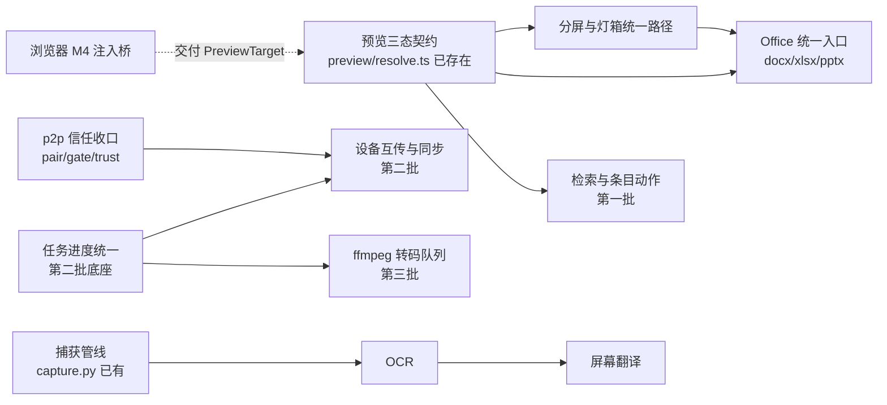

# Sunday 下一阶段 · 统一实施安排（浏览器/预览器 × Relay × Easy Tools）

- 日期：2026-11-16
- 范围：桌面端（Windows / WebView2）；移动端只在 Relay 的 P2 里作为「对端」出现
- 状态：安排定稿，待用户集中验收
- 唯一真源：`方案/内置浏览器-01-总体方案.md`（下称「浏览器 01」）、`agent_docs/p2p-remote.md`（下称「p2p 文档」）
- 写作口径：每条结论落到当前工作树的文件或已发生的对话事实；拿不到证据的标「待确认」并给推荐

## 1 结论摘要

1. 三条线共 7 个阶段：浏览器 1 个（M4）、Relay 3 个（P0 收尾 / P1 / P2）、Easy Tools 3 批；浏览器 M1–M3 已落地，不再排期。
2. 当前最该做的不是新功能，而是**把已经写进去的东西验收掉**：13 项真机测试里的 5 项优先项，直接决定临时会话能否对用户开放。
3. Easy Tools 第一批全部落在已有文件上（`core/ui/src/preview/`、`tool/workspace_files.py`、`tool/library_tools.py`），零新依赖，是本阶段性价比最高的一段。
4. Relay 只有一件事是硬的：`sunday-p2p.exe` 进正式安装包 —— `core/desktop/src-tauri/tauri.conf.json:78` 的 `resources` 目前只有 `SundayCore`。配对与撤权骨架已在（`core/p2p/src/pair.rs` 377 行、`gate.rs` 381 行、`trust.rs` 270 行），属收尾不是新建。
5. 浏览器 M4 是唯一需要新写大量代码的阶段（注入桥指令集 + 接管状态机），且它**不阻塞**另外两条线。
6. 设备互传是三条线的真正交汇点：p2p 的信任 + aria2 的队列 + 预览器的呈现，三样都已存在，缺的是接线，不是新造。
7. 外部依赖级能力（Everything / ffmpeg / OCR / ASR）一律按需下载、不进安装包，理由是一次性体积与许可证，不是技术难度。
8. 本阶段任何时候都不引入 CDP、EasyTier、独立内核、自建 relay/代理节点。

## 2 现状与不重复开发清单

### 2.1 能力清单

| 能力 | 现状 | 代码位置（已核实） | 本次是否需要动 |
| --- | --- | --- | --- |
| 浏览器标签骨架（导航/搜索/多标签/拖动排序/独立历史/popup/查找/缩放/全屏/重启恢复） | 已落地（M1） | `core/desktop/src-tauri/src/browser/`（`mod.rs`/`tabs.rs`/`webview.rs`/`platform_win.rs`/`shortcut.rs`/`favicon.rs`）；`core/ui/src/components/CoreSplitBrowser.vue`、`split/browserOverlay.ts`、`split/layout.ts` | **不动**。M4 只加新命令与新指令，不改标签模型 |
| 会话三态（normal / incognito / 自定义目录） | 接口已就位，真机行为未验证（M2） | `browser/session.rs`（`BrowserProfile::parse` / `resolve`）、`browser/webview.rs:103-108` | **只做验证**（13 项里的 P1 四项），不改设计 |
| 权限默认拒绝 + 最小授权、证书阻断、按 host 清存储（缓存不动）、`browser_diagnostics` 越权自检 | 已落地（M2） | `browser/security.rs`、`browser/platform_win.rs`、`browser/session.rs` | **不动**。只补一条真机确认（权限确认后是否真正放行） |
| 下载接管（`on_download`，三态列表，危险后缀二次确认） | 已落地（M3） | `browser/download.rs`、`browser/platform_win.rs` | **不动**。Easy Tools 第二批直接复用它的落盘策略 |
| 媒体 / PDF 原生呈现、手动上传 | 已落地（M3） | 同上 + WebView2 内置查看器 | 不动。程序化上传本版明确不做（浏览器 01 §八） |
| 预览器底座（`PreviewTarget` 契约 / 三态解析 / 灯箱 / 交接） | 已存在，且灯箱已用 | `core/ui/src/preview/`：`target.ts:33`（三型联合）、`resolve.ts:19`（`native`/`rendered`/`unsupported`）、`:175`（`resolvePreviewDocument`）、`PreviewSurface.vue`、`PreviewLightbox.vue`、`browserHandoff.ts`、`transport.ts` | **只扩严，不重写**。第一批把「分屏也走这一层」补上 |
| 分屏内预览（自行按扩展名分派） | 已落地，但与 `preview/` 是两套分派 | `core/ui/src/components/CoreSplitPreview.vue:22`、`:106`（pptx→`renderSlides`）；`core/ui/src/split/preview.ts:3-14` | **要动（收口）**：让它复用 `resolve.ts` 而不是自己再分派一次 |
| 下载引擎（队列/续传/限速/校验/选线/DoH 诊断） | 已具备，版本与校验和固定 | `core/src/lamtools_core/plugins/bundled/network-exploration/`；`engine_install.py:15`（aria2 `release-1.37.0` + sha256）、`:16`（mihomo `v1.19.33` + sha256） | **不动**。互传与转码复用其队列 |
| 截图与标注（框选/箭头/文字/画笔/色板/撤销重做/裁剪导出） | 已具备 | `core/ui/src/pet/ui/CaptureEditor.vue`（实际在 `pet/ui` 下，不在 `components/`）、`components/PingCaptureSandbox.vue`、`desktop_overlay.rs` | **不动**。OCR 只接在它的导出帧之后 |
| 捕获管线（编码、缩放、网格标注、目标标注、帧差） | 已具备 | `core/src/lamtools_core/computer_use/capture.py`、`session.py`、`uia.py`、`win32.py` | **不动**。屏幕翻译复用其取帧，不新写抓屏 |
| 资料库（收藏/标签/评分/归档/软删恢复/按层） | 已具备 | `core/src/lamtools_core/artifact/{store,registry,seed}.py`；`tool/library_tools.py:74`（`list/register/favorite/folder/tag/rate/use/remove/restore` 9 个动作；用户材料提到的「对比」不在该枚举内，属界面能力，**待确认**） | **不动**。只补界面入口（预览/转换/打开默认应用） |
| 工作区检索（glob + 内容匹配，单工作区，带扫描预算） | 已具备，无界面 | `tool/workspace_files.py:31-42`（50 条结果、10 万条目、2 MB/文件、墙钟预算）；`:48`/`:52` 提前停止提示 | **只补 UI**（第一批），不改匹配与预算 |
| 文档文本提取（docx/pdf/xlsx） | 已具备，范围明确 | `tool/document_normalize.py` | **不动**。pptx 文本提取属缺口，见 §8 风险 4 |
| P2P 传输（身份/配对票据/可信设备/QUIC JSON 帧/RPC 代理/事件泵） | 已具备，**无文件互传** | `core/p2p/src/`（`identity.rs`/`pair.rs`/`gate.rs`/`trust.rs`/`rpc.rs`/`proxy.rs`/`events.rs`/`qr.rs`/`scan.rs`/`ticket.rs`/`link.rs`/`bin/cli.rs`）；`core/desktop/src-tauri/src/p2p_host.rs`（496 行，`:62` 找可执行文件、`:88` 缺文件时的报错文案） | **不动协议**。互传在 RPC 之上加方法，不改帧格式 |
| 旧手机控制网关 | 已删除 | `core/desktop/src-tauri/src/remote/` 现只剩 `fixtures/` | 不动（这是「已删干净」的证据） |
| `sunday-p2p.exe` 随包分发 | **缺口** | `tauri.conf.json:78`（`resources` 只有 `SundayCore`） | **要动**（Relay P0 第三项） |

### 2.2 五条「别重复开发」硬规则

1. **预览的三态解析只有一份**：`preview/resolve.ts`。任何「docx/xlsx/pptx 怎么显示」的判断都必须问它，禁止在 `CoreSplitPreview.vue`、新组件、浏览器侧各写一份。
2. **浏览器不解析 Office**：按浏览器 01 §3.9 只依赖 `PreviewTarget` 契约；浏览器侧出现第二份 docx/xlsx/PDF 解析即为返工。
3. **下载只有一条通道**：`browser/download.rs` 的落盘策略 + `network-exploration` 的 aria2 队列。互传、转换产物都走它们，不新起下载器。
4. **传输协议不动**：`core/p2p` 的 ALPN `sunday/p2p/1` 与四类帧（`call`/`reply`/`error`/`event`）不改；互传是**新增 method**，不是新协议。
5. **资料库不新建并行目录**：标签与评分已在 `artifact` 记录上，禁止再建「样式分区」这类第二套模型（`方案/Library增强-样式展示与标签评分.md` §二已判过死刑）。

> 浏览器 01 §2.3 的第三处「不一致」**已消解**：`core/ui/src/preview/` 在当前工作树确实存在（`target.ts`/`resolve.ts`/`PreviewSurface.vue`/`PreviewLightbox.vue`/`browserHandoff.ts`/`transport.ts`/`hostPreference.ts`/`usePreviewLightbox.ts`）。该条可从「待验证」回填为「已核实」。

## 3 三条工作线的阶段安排

### 3.1 浏览器线：M4 = Agent 感知与操作

M1–M3 的范围、规则与验收详见浏览器 01 §四，已落地，本文不复述。

**M4 内容**（按实现顺序）：

1. 注入桥指令集扩写：在 `browser/bridge.rs` 现有最小版（注入 + WebMessage 连通 + `snapshot(interactive)`）之上补齐 `browser 01 §3.7` 的指令表（`click`/`type`/`clear`/`pressKeys`/`select`/`hover`/`scroll`/`drag`/`waitFor`/`readText`/`getHtml`/`find`）。
2. 快照语义：`ref` 复用（`WeakMap<Element,string>`）、`stale_ref` 自动重快照一次、可见性三重判定（`getBoundingClientRect` + `getComputedStyle` + `elementFromPoint`）、shadow DOM 穿透、同源 iframe 递归 / 跨源只报 bounds。
3. 视觉回退：命中浏览器 01 §3.7 的六个触发条件任一时，走 `computer_use` 截图 + 坐标，结果带 `fallback: 'visual'` 与截图证据。
4. 接管状态机：`isTrusted` 上报 `user-input` → 标签置 `human-owned` → 拒绝写指令只允许读 → `browser_request_control` 走一次用户确认。`browser_request_human` 接任务条与系统通知。
5. 后台操作保守策略：**临时显示 → 操作 → 切回**；不启用 `TrySuspend`/`Resume`；`waitFor` 一律事件驱动，不依赖后台计时器精度。
6. 截图：`CapturePreview` 的 `viewport` 与 `element(ref)`（视口截图 + bounds 裁剪）；`fullPage` 明确返回 `unsupported`。

| 维度 | 说明 |
| --- | --- |
| 用户新增什么实际能力 | 一句话让 Agent 办网页上的事（搜索、打开、读结构、填表、点按钮），过程中随时能自己接手；Agent 不再「只会看截图猜坐标」 |
| 复用了哪些已有实现 | `browser/bridge.rs` 最小版、`browser/platform_win.rs`（COM 封装）、`browser/tabs.rs` 标签模型与 `owner` 字段、`computer_use/capture.py`（视觉回退取帧）、`browser/security.rs`（`require_main` 与权限口径）、`browser/download.rs`（`download` 指令走同一落盘策略） |
| 解决什么问题 | M1–M3 让浏览器「能看能点」，但没有 Agent 通道；这是「浏览器作为 Agent 手脚」的最后一公里 |
| 遗留缺陷 | ① `upload` 无法程序化设文件，只能报错转人工（浏览器 01 §附录 A `unsupported`）；② 跨源 iframe 内元素不可达，只能视觉回退；③ `fullPage` 截图不做；④ 快照对 canvas/WebGL 站点基本无效；⑤ 桥在主世界执行，页面可改写桥对象（靠「可信数据一律由 Rust 侧 COM 取」兜底） |
| 后续如何复用 | 指令集是枚举式的，新增能力 = 加一条 `op` + 一段注入代码；`ref` 体系与 `browser 01 §附录 B` 的消息形状一旦稳定，Easy Tools 的「网页取内容」与预览器的 `web-extract` 交接都用同一套快照，不需要第二套抽取器 |

**13 项真机测试 = 验收 backlog**（细则在 §6.1，本节只定优先级）。**测试未完成不阻塞 Relay 与 Easy Tools 任何一条线**；它只阻塞「临时会话对用户开放」这一个开关。

| 组 | 项 | 优先 |
| --- | --- | --- |
| P1（阻塞 M2 验收，浏览器 01 §附录 C） | E1 临时会话隔离三条语义（登录态 / 敏感存储 / 不持久化） | **★优先** |
| | E2 自定义目录对照（两目录两账号互不串） | |
| | E3 独立 Environment 下 Rust 仍能控制标签（`browser_state`、`on_page_load`、注入脚本、`tauri://`） | **★优先** |
| | E4 原生 WebView 与浮层遮挡（菜单/模态/右栏/切标签/拖动/下载面板） | **★优先** |
| P2（不阻塞任何里程碑，只定后台策略） | 后台 rAF 节流比 | |
| | 后台 `setInterval` tick 数 | |
| | 后台视频是否继续出声 | |
| | `TrySuspend`/`Resume` 是否丢状态 | |
| | 隐藏页 `ExecuteScript` 是否返回 | |
| M2/M3 行为确认 | 权限确认后是否真正放行（`getUserMedia` 不再报 `NotAllowedError`） | **★优先** |
| | 站数据清理后缓存文件数不变（只清存储） | |
| | 文件拖放（`dragDropEnabled: false` 对子 webview 的影响） | **★优先** |
| | 证书错误页（自签域名 + hosts） | |

### 3.2 Relay 线

**约束写死**：保留 Sunday Relay + Iroh；不引入 EasyTier；不重写协议（`sunday/p2p/1`）；不自建服务器/代理节点。核心问题在**设备授权、生命周期、业务状态、恢复**四件事，不在传输能力。

#### P0 —— 收尾（进行中）

| 维度 | 说明 |
| --- | --- |
| 用户新增什么实际能力 | 装机即可用：装上正式版就能配对，不再要求用户手动找 `sunday-p2p.exe`；撤销设备立刻生效；配对过程不再「谁先连谁可信」的模糊态 |
| 复用了哪些已有实现 | `core/p2p/src/pair.rs`、`trust.rs`、`gate.rs`（配对与信任判定的现有实现）、`qr.rs`/`scan.rs`（票据与扫码）、`p2p_host.rs`（起停与转述）、`remote/`（旧网关已删，不复活） |
| 解决什么问题 | ① 安全配对：把「首次连接即配对」收敛成可见、可确认、可拒绝的流程；② 即时撤权：撤权后当前连接立即失效，而不是等下次握手；③ 打包：`sunday-p2p.exe` 必须随安装包出现 |
| 遗留缺陷 | `p2p_host.rs:88` 现在的「找不到传输程序」只是错误文案，说明打包路径还没闭合；`tauri.conf.json:78` 的 `resources` 只有 `SundayCore`，需要加 sidecar/resources 并同步 `p2p_host.rs:62-67` 的查找顺序 |
| 后续如何复用 | 信任判定与撤权是互传的唯一前置（见 §4），P0 一收口，第二批的设备互传可以直接开工，不需要再审一遍权限模型 |

#### P1 —— 连接质量与状态真实

| 维度 | 说明 |
| --- | --- |
| 用户新增什么实际能力 | 打开就自动连着（不需要每次点「接受连接」）；界面上的「已连接」是真的已连接；断线自己回来；消息不丢不重；连接中的等待有进度而不是空白 |
| 复用了哪些已有实现 | `p2p_host.rs` 的子进程生命周期与 `TICKET`/`READY` 解析、`events.rs`（事件泵，含断线重连）、`gate.rs`（可信判定）、`RemoteTransport`（与本地 IPC 同形状的还原） |
| 解决什么问题 | ① 自动连接；② 消除假在线（状态来自真实链路而非上次缓存）；③ 自动恢复；④ 消息可靠性（应答按 `id` 配对，断流时把等待中的调用一次性置失败——`p2p 文档`「事件通道」已写到这条，P1 要把它做到可观测）；⑤ 连接等待体验 |
| 遗留缺陷 | 「假在线」的根因在 UI 状态与链路状态两套真源，P1 之后仍需一条「链路状态是唯一真源」的断言；恢复策略对 Android 前后台切换无效（见 P2） |
| 后续如何复用 | 这套「链路状态 + 重连 + 调用失败收敛」是设备互传的底座：互传任务断线也要能续，不该再写第二套重试逻辑 |

#### P2 —— 体验与 Android

| 维度 | 说明 |
| --- | --- |
| 用户新增什么实际能力 | 能看见文件传到哪个路径；能在多台设备间切换；不用的设备会被清掉；手机上前后台切换不断连 |
| 复用了哪些已有实现 | P1 的链路状态、`trust.rs` 的设备清单、`p2p_host.rs` 的设备枚举 |
| 解决什么问题 | 路径显示（传输结果可定位）、设备切换（多端选择明确）、清理轮询（离线设备不堆积）、Android 前后台（退到后台不断链） |
| 遗留缺陷 | Android 侧只在本机宿主验证过；真机整链（手机扫码连电脑、看会话、发消息、收审批）仍是 `p2p 文档`「还没做」的第 1 条 |
| 后续如何复用 | 设备清单与路径显示直接被互传的「传到哪」复用 |

### 3.3 Easy Tools 线

按入口组织：**文件**（预览、检索、条目动作、互传）、**网络**（下载、代理、诊断）、**输入**（截图、捕获、OCR）、**Ping**（批注到会话）。

#### 第一批 —— 收口（几乎零新依赖）

三项，按顺序做：

1. **预览收口**：让分屏也走 `preview/resolve.ts`。现状是两套分派——灯箱用 `resolve.ts:175`，分屏在 `CoreSplitPreview.vue` 自己按扩展名分支（`:106` pptx→`renderSlides`），`split/preview.ts:3-14` 又维护一份扩展名表。收口后 `docx/xlsx/pptx` 只有一条统一路径：`PreviewTarget` → `resolvePreviewDocument` → 三态 → `PreviewSurface`。
2. **文件检索 UI**：`tool/workspace_files.py` 的 glob + 内容匹配与扫描预算已完整（`:31-42`、`:48`/`:52`），缺的是界面。做法是给现有检索加一个可点开的入口，展示「命中数 / 是否因预算提前停止」，不新增后端能力。
3. **资料库条目动作**：条目上补三个动作——「预览」（生成 `PreviewTarget{kind:'file'}` 交给预览器）、「转换」（走第一批已有的渲染路径产出可预览形态）、「打开默认应用」（系统壳）。三个动作都只调用已有能力。

| 维度 | 说明 |
| --- | --- |
| 用户新增什么实际能力 | 在资料库里点一个 docx/pptx 就能看到内容（不再只显示扩展名）；能搜文件并看到搜得全不全；条目上直接预览/转换/用系统程序打开 |
| 复用了哪些已有实现 | `preview/{target,resolve,transport}.ts`、`PreviewSurface.vue`、`PreviewLightbox.vue`、`CoreSplitPreview.vue` 的既有渲染器（docx-preview / read-excel-file / fflate / pdfjs-dist 均在 `core/ui/package.json:55/58/64/65`）、`tool/workspace_files.py`、`artifact/{store,registry}.py`、`tool/library_tools.py:74`、本机字节通道（`http/routes.py:780` 的 `FileResponse` 带 Range） |
| 解决什么问题 | 预览器「灯箱与分屏两套分派」的长期漂移；资料库能存不能看；文件检索有后端没入口 |
| 遗留缺陷 | ① pptx 只有前端的 `renderSlides`，后端 `document_normalize.py` 只提 docx/pdf/xlsx 文本——「转换」对 pptx 只能产出图片式预览，不是文本；② 分屏收口后 `split/preview.ts` 的扩展名表仍被别处引用，需一次清理才能删；③ 检索仍是单工作区 |
| 后续如何复用 | 统一后的 `PreviewTarget` → `resolve` 链路是互传落地页的呈现方式（收到文件直接预览）；「转换」的产物进资料库后带 `preview_kind`，卡片能展示真实样子 |

#### 第二批 —— 设备互传与同步

| 维度 | 说明 |
| --- | --- |
| 用户新增什么实际能力 | 手机与电脑互发文件；一处改动另一处能看到；传输有队列、进度、断点续传 |
| 复用了哪些已有实现 | `core/p2p` 的 RPC 与事件泵（新增 method，不改帧）、Relay P0 的信任与撤权、`network-exploration` 的 aria2 队列（续传/限速/校验）、`browser/download.rs` 的落盘策略、第一批的预览（收到的文件立即预览）、`artifact` 资料库（收到即归档） |
| 解决什么问题 | p2p 现在只有 RPC 代理，没有任何文件能力；而「发个文件」是设备联动最高频的需求 |
| 遗留缺陷 | 冲突处理（同名文件、双向同改）需显式策略；大文件走 QUIC 流要单独做分块与断点；同步语义（单向镜像 vs 双向合并）本批只做单向，双向留待确认 |
| 后续如何复用 | 传输队列 = 任务进度能力的第一个消费者，ffmpeg 转码队列直接用同一套进度与取消 |

#### 第三批 —— OCR → 屏幕翻译 → ASR/ffmpeg

| 维度 | 说明 |
| --- | --- |
| 用户新增什么实际能力 | 截一块屏幕就能取到文字；看外语页面/视频时能就地翻译；录音与视频能转文字、能转码 |
| 复用了哪些已有实现 | `computer_use/capture.py`（取帧、缩放、标注）、`pet/ui/CaptureEditor.vue`（框选区域即 OCR 输入）、`network-exploration/engine_install.py`（按需下载 + sha256 + 许可证登记的既有模式）、第二批的任务进度 |
| 解决什么问题 | 输入侧只有「截图给人看」，没有「截图给机器读」；转码/录屏/语音三件事全缺 |
| 遗留缺陷 | OCR 引擎二选一未定（见 §8 风险 4）；ASR 模型体积大，首次下载体验需设计；ffmpeg 只能选 LGPL 构建，功能子集受限 |
| 后续如何复用 | `engine_install.py` 的「固定版本 + sha256 + 许可证字段」模式是这类外部依赖的统一入口，Everything 若将来获批也走它 |

## 4 依赖关系与可并行项

### 4.1 依赖图（12 节点）

读法：`A` 与 `J` 是**已存在**的底座（不用重新造）；`M` 只是把成果交给 `A`，不是 `A` 的前置。

### 4.2 可并行（互不触碰同一文件）

| # | 工作项 | 独占文件域 |
| --- | --- | --- |
| 1 | 浏览器 M4（Rust 侧桥与指令） | `core/desktop/src-tauri/src/browser/bridge.rs`、`platform_win.rs` |
| 2 | Relay P0/P1 | `core/p2p/src/**`、`core/desktop/src-tauri/src/p2p_host.rs` |
| 3 | Easy Tools 第一批「预览收口」 | `core/ui/src/preview/**`、`components/CoreSplitPreview.vue` |
| 4 | Easy Tools 第一批「检索 UI」 | 检索面板新组件 + `tool/workspace_files.py`（只读调用） |
| 5 | Easy Tools 第一批「条目动作」 | 资料库卡片/详情组件 |

1/2/3/4/5 五条可同时开工：文件域无交集，且第 3 条依赖的 `preview/` 已存在，不需要等任何人。

### 4.3 必须串行（共享文件）

| # | 共享点 | 冲突表现 |
| --- | --- | --- |
| 1 | `core/desktop/src-tauri/src/main.rs` 命令注册 | 浏览器 M4 新命令、Relay 命令、互传命令都要改同一处 `invoke_handler` |
| 2 | `core/ui/src/split/layout.ts` + `SplitWorkspace` | 浏览器标签、预览 pane、互传落地页都改布局模型 |
| 3 | `core/ui/src/split/preview.ts` | 预览收口与 Office 统一入口同时改它，且它还被别处引用 |
| 4 | `core/desktop/src-tauri/tauri.conf.json` | 浏览器线的 capabilities/CSP 与 Relay 的打包 `resources` 改同一个 JSON |
| 5 | `core/src/lamtools_core/tool/library_tools.py` | 条目动作与检索 UI 都可能扩同一份 schema |
| 6 | `core/p2p/**` + `p2p_host.rs` | Relay 独占；互传只能新增 method，不得并行改帧格式 |

### 4.4 冲突规避规则

1. **一个文件同一时间只归一条线**；跨线需求由该文件的归属线代做，在提交说明里写清「代谁改的」。
2. **`main.rs` 只在集成分支改**：各线先在自己模块导出 `#[tauri::command]` 函数，注册由一次集中提交完成，避免三方同时改 `invoke_handler`。
3. **`preview.ts` 归 Easy Tools 第一批**：浏览器线按浏览器 01 §3.9 只依赖 `PreviewTarget` 契约，不得改它。
4. **`tauri.conf.json` 变更集中一次**：capabilities（浏览器）与 `resources`（Relay 打包）合并成一次提交，避免 JSON 反复冲突。
5. **分支按作者命名空间**：`sunday/` 前缀（项目既定），每条线一个分支，合并前先 rebase 集成分支。
6. **验收不互相等待**：任何一条线的验收失败不阻塞另一条线的合并，只有共享文件的改动需要等归属线就绪。

## 5 优先级与理由

评分口径（每维 1–5，成本维「越低越高分」）：

| 排序 | 项目 | 成熟度 | 即时收益 | 复用度 | 成本（低=高） | 架构契合 | 总分 |
| --- | --- | --- | --- | --- | --- | --- | --- |
| 1 | 浏览器 13 项真机（先做 5 项优先） | 5 | 5 | 4 | 5 | 5 | **24** |
| 2 | Easy Tools 批 1 · 预览收口 | 5 | 4 | 5 | 5 | 5 | **24** |
| 3 | Easy Tools 批 1 · 文件检索 UI | 5 | 4 | 4 | 5 | 4 | **22** |
| 4 | Easy Tools 批 1 · 条目动作 | 4 | 4 | 4 | 4 | 5 | **21** |
| 5 | Relay P0 打包收尾 | 4 | 5 | 3 | 4 | 5 | **21** |
| 6 | 浏览器 M4 注入桥 | 2 | 5 | 4 | 2 | 5 | **18** |
| 7 | Relay P1 连接质量 | 3 | 4 | 3 | 3 | 5 | **18** |
| 8 | Easy Tools 批 2 · 设备互传 | 3 | 5 | 4 | 2 | 4 | **18** |
| 9 | Easy Tools 批 3 · OCR + 屏幕翻译 | 2 | 4 | 4 | 2 | 4 | **16** |
| 10 | Easy Tools 批 3 · ASR / ffmpeg | 2 | 3 | 3 | 1 | 3 | **12** |

**为什么 1、2 并列第一**：两者成熟度都是 5（代码已在、只差验证或收口），成本都接近零，但收益性质不同 —— 第 1 项解锁「临时会话能不能给用户」，第 2 项消除「两套预览分派」这个会持续产生返工的架构债。第 1 项先做，因为它有门禁性质（浏览器 01 §6.1 ③：验证不通过要重新批准，不能悄悄降级）。

**为什么 M4（第 6）不排前面**：成熟度只有 2（`bridge.rs` 只是最小版），成本是三条线里最高的（几百行注入 JS + 状态机），而它服务的「Agent 操作网页」是全新能力、没有存量用户期待。它也不是其它项的前置（§4.1 里 `M` 只指向 `A`，方向是交付不是依赖），所以不必抢跑。

**为什么设备互传（第 8）不排前面**：即时收益是全表最高的之一，但成本高（分块、断点、冲突）且有两个硬前置（Relay P0 的信任收口、任务进度能力）。它是三条线真正的交汇点，价值在「接起来」，前置没到位时先做等于重做。

**被推迟的项目与原因**：

| 项目 | 推迟理由 |
| --- | --- |
| 浏览器 M4 的 `upload` 程序化上传 | WebView2 无公开接口，CDP 已禁用（浏览器 01 决策 2），做不成不如明确报错 |
| 浏览器 P2 后台策略的「省资源」优化 | 后台行为未证实（§6.1 第 5–9 项），先按保守策略走，不做基于假设的优化 |
| Relay P2 Android 前后台 | 依赖真机整链验收，而该验收本身还没做（`p2p 文档`「还没做」第 1 条） |
| 设备互传的双向同步 | 「单向镜像」能独立验收且风险低；双向合并的冲突语义需要产品决策，属**待确认**（推荐：先单向，双向等真实使用反馈） |
| ASR / ffmpeg | 体积与许可证（§8 风险 2、3），且它们只服务少数场景，等 OCR 验证「按需下载」这条路走得通再做 |
| Everything 级全盘索引 | 需闭源 SDK 与分发条款审查（§8 风险 1），本阶段不做 |

## 6 集中验收清单

一次性集中验收使用。每项给出「怎么验 / 通过标准 / 失败说明什么」。

### 6.1 浏览器 13 项真机

前置：记录 WebView2 Runtime 版本（`Get-AppxPackage *EdgeWebView*`），否则无法解释机器间差异（浏览器 01 §附录 C 已写死这条）。

| # | 项 | 怎么验 | 通过标准 | 失败说明什么 | 优先 |
| --- | --- | --- | --- | --- | --- |
| 1 | 临时会话隔离（E1） | incognito 标签登录站点 A（或本地页写 cookie + localStorage + IndexedDB），再开 normal 标签访问同站 | 三条全过：登录态隔离、敏感存储隔离、关闭重开仍未登录 | 要么 `incognito(true)` 被旧 Runtime 静默降级（`if let Ok(env10)`），要么用法错误；带证据回报，不自行降级 | ★ |
| 2 | 自定义目录对照（E2） | 两标签分别 `webview2/profile-a`、`profile-b`，各登录不同账号 | 账号与存储互不串；**两者都持久化属预期** | 目录没真正变成独立 `WebContext`，需查 `browser/session.rs` 的 `resolve` 是否真把目录传进 builder | |
| 3 | 独立 Environment 下仍可控（E3） | 在 incognito/自定义目录标签里读 `browser_state`、看 `on_page_load`、验证注入脚本、访问 `tauri://` | 四项全正常 | 该 profile 标签只能降级为只读浏览（浏览器 01 §6.3 已定此退路），Agent 能力对临时会话不可用 | ★ |
| 4 | 原生 WebView 与浮层遮挡（E4） | 依次触发右键菜单、模态、右栏、切标签、拖动分屏、下载面板 | 浮层出现即隐藏、消失即恢复；无残影；网页不盖菜单 | `browserOverlay` 的可见性判定不是纯函数、或多标签后漏了某个浮层来源 | ★ |
| 5 | 后台 rAF 节流 | 同页前后台各 10s 的 rAF 计数 | 后台 < 前台 1/4 | 不失败也不降级：证明「后台会自己变安静」不成立，`waitFor` 必须事件驱动（现已如此） | |
| 6 | 后台 `setInterval` | 前后台各 10s 的 100ms 定时器 tick 数 | 同上口径 | 同上 | |
| 7 | 后台视频音频 | 后台标签播带音轨视频 | 记录是否出声 | 出声则需主动 pause，否则用户会遇到「找不到的声音」 | |
| 8 | `TrySuspend`/`Resume` | 挂起前写 `scrollY`/输入框/`sessionStorage`，恢复后读 | 三者全保留 | 任一丢失 → 不启用休眠（现状即不启用，故不阻塞交付） | |
| 9 | 隐藏页 `ExecuteScript` | `IsVisible=false` 时执行脚本等返回 | 有返回值 = 后台可操作；超时 = 后台必须临时显示 | 决定 M4 的「临时显示→操作→切回」是必需还是可选 | |
| 10 | 权限确认后真正放行 | 页面请求摄像头 → 默认应被拒（`NotAllowedError`）→ 手动允许后看是否出画面 | 拒绝生效，允许后画面出现 | 「允许」没生效说明 `PermissionRequested` 只改了 UI 状态、没回灌给 WebView2 | ★ |
| 11 | 站数据清理只清存储 | 登录 → 点「清除站点数据（不含缓存）」→ 刷新查登录态；比对清理前后 `EBWebView` cache 文件数 | 变为未登录 + 缓存文件数一致 + 界面文案含「不含缓存」 | 缓存被顺带清了：违反浏览器 01 决策（缓存不动），需回滚该实现 | |
| 12 | 文件拖放 | 从资源管理器拖文件进网页上传区；从网页拖图片出到桌面 | 两向都有反应 | 主窗口 `dragDropEnabled: false`（`tauri.conf.json:25`）压到了子 webview，需在子 webview 单独开 | ★ |
| 13 | 证书错误页 | 自签域名进 hosts，访问 https | 显示可读错误页且发生阻断，不是白页 | 说明 `ServerCertificateErrorDetected` 接口代次没探对（浏览器 01 §附录 C 列为待验证） | |

**判定**：1/3/4/10/12 五项（★）全过 → 临时会话与 Agent 操作可对用户开放；1 与 3 任一不过 → 按浏览器 01 §6.1 ③ 门禁带证据回报，临时会话入口置灰并说明「本版本不可用」，**不得**用「关闭时清数据」冒充。

### 6.2 Relay P0

| # | 项 | 怎么验 | 通过标准 | 失败说明什么 |
| --- | --- | --- | --- | --- |
| 1 | 安全配对 | 桌面出票据 → 手机扫码/粘贴 → 观察是否出现可见的确认与拒绝路径 | 未确认前不写入可信名单；拒绝后该设备不能调任何方法 | 仍是「首次连接即静默信任」，说明 `pair.rs` 的新流程没接到 `gate.rs` 的判定上 |
| 2 | 即时撤权 | 连上后撤权，立刻发一次调用 | 当前连接立即失效（拒绝或断开），不等下次握手 | `trust.rs` 只在握手时读名单，撤权需同时断开活跃链路 |
| 3 | `sunday-p2p.exe` 进正式安装包 | 干净机器装正式版 → 打开远程连接页 → 生成票据 | 不需要用户手工放文件；`p2p_host.rs:88` 的错误文案不再出现 | `tauri.conf.json:78` 的 `resources` 仍只有 `SundayCore`，或 `p2p_host.rs:62-67` 的查找顺序与打包路径不一致 |

### 6.3 Easy Tools

**第一批**

| # | 项 | 怎么验 | 通过标准 | 失败说明什么 |
| --- | --- | --- | --- | --- |
| 1 | 预览收口 | 灯箱与分屏各打开一份 docx/xlsx/pptx | 两条路径产出的 `PreviewDocument.mode` 一致（同为 `rendered` 或同为 `unsupported`），且 `grep` 显示分屏不再自行分派 | 分屏还在用 `CoreSplitPreview.vue:106` 的自实现分派，收口没做进调用链 |
| 2 | 文件检索 UI | 在工作区搜一个已知词，再看一个超大目录 | 结果与 `workspace_files.py` 一致；因预算提前停止时有明确提示 | 界面自己算了结果或吞掉了「提前停止」，用户会以为搜全了 |
| 3 | 条目动作 | 资料库点条目 → 预览 / 转换 / 打开默认应用 | 预览走 `PreviewTarget{kind:'file'}`；转换产物进库并带 `preview_kind`；打开默认应用起系统壳 | 任一动作用了第二套路径（自己拼 URL、自己解析 docx），即为重复开发 |

**第二批**（设备互传）

| # | 项 | 怎么验 | 通过标准 | 失败说明什么 |
| --- | --- | --- | --- | --- |
| 1 | 互发文件 | 手机→电脑、电脑→手机各发一个中等文件 | 收到、落盘路径可见、可直接预览 | 传输依赖了新协议或新下载器，说明没复用 p2p + aria2 |
| 2 | 断点续传 | 传输中拔网再恢复 | 从断点续，不从头重来 | 说明分块与续传没做，只是整文件重传 |
| 3 | 未授权设备 | 未配对设备尝试传输 | 被拒且不产生任何落盘文件 | 信任判定没覆盖互传 method，只覆盖了 RPC 代理 |

**第三批**（OCR / 屏幕翻译 / ASR / ffmpeg）

| # | 项 | 怎么验 | 通过标准 | 失败说明什么 |
| --- | --- | --- | --- | --- |
| 1 | 截屏取字 | 框选一段屏幕文字 → OCR | 文本可用，中英混排不崩 | 取帧走了第二套抓屏（新写的），应复用 `computer_use/capture.py` |
| 2 | 屏幕翻译 | 外语页面截取 → 翻译 | 译文贴回原位置或成列表可读 | 翻译链路依赖了未登记的在线服务，需按 §7 重新界定 |
| 3 | 按需下载 | 首次触发 OCR / 转码 | 有明确下载提示、sha256 校验、许可证可见（沿用 `engine_install.py:15-16` 的模式） | 把外部依赖塞进安装包，违反 §8 风险 2 的口径 |

## 7 不做清单

合并三条线，全部为「本阶段不做，且不需要再讨论」：

| 不做 | 理由 |
| --- | --- |
| 浏览器扩展生态（WebExtension） | WebView2 不支持扩展模型；模拟成本远超收益 |
| 独立浏览器内核（Chromium/Gecko 自编译） | 违背「复用系统 WebView」硬约束，体积与维护不可接受 |
| 自建服务器 / 自建代理节点 / 自建 relay | 账号与自建 relay 那条路已随旧网关删除；relay 只按节点 id 转发加密流量 |
| EasyTier | 传输层已由 Sunday Relay + Iroh 覆盖，再引入一套组网是重复投资 |
| 重造 Library / Relay / Agent Loop | 三者都已成型（`artifact/`、`core/p2p`、工具循环），本阶段只接线不加层 |
| 启用 CDP（`CallDevToolsProtocolMethod`） | 浏览器 01 决策 2：安全面变更，不是配置项、不设开关 |
| 命名 profile（`SetProfileName`） | tauri 未透传，需牵引 `webview2-com` 与 `windows` 升级；`data_directory` + `incognito` 已够 |
| 「清除全部缓存」入口 | 浏览器 01 已决策只清存储、缓存不动 |
| 以「关闭后目录被删/为空」当隔离验收口径，或主动删 profile 目录 | 会误删用户登录态；正确口径是「销毁 webview + profile 生命周期结束」 |
| 移动端任何新形态 | 项目规则：只考虑桌面端；Android 只作为 Relay 的对端参与验收 |
| 浏览器承担 DOCX/XLSX/PPTX 解析 | 按浏览器 01 §3.9 交给预览器 |
| 预览器承担专业编辑（改 Word/Excel/视频） | 预览器是内容终点，只查看 |
| 下载的暂停/继续/取消与字节级进度 | `on_download` 只给开始/完成；要进度就得换掉 wry 的下载处理，代价大于收益 |
| 程序化 `upload`（自动填文件） | WebView2 无公开接口且 CDP 禁用；明确报错转人工 |
| Everything SDK 全盘索引（本阶段） | 闭源二进制的分发条款未核（§8 风险 1），且与「单工作区 + 预算扫描」的现有语义冲突 |
| 双轨浏览器（保留旧 `split_browser` 一套） | 浏览器 01 §3.11 的硬性检查：`grep split_browser` 必须为空 |

## 8 风险

| # | 风险 | 影响 | 处置 |
| --- | --- | --- | --- |
| 1 | **Everything 分发条款**：需 Everything SDK/IPC 与闭源二进制，分发条款待核 | 可能整套方案不可分发，或只能「用户自装」 | 推荐：本阶段不做；若将来要做，先确认是否可只走 IPC 调用用户自装实例（不随包分发），那样不触分发条款 —— **待确认** |
| 2 | **ffmpeg 许可证与体积**：LGPL 构建才可随包，GPL 构建会传染；随包体积数十 MB，且要附源码指引 | 选错构建 = 整个产品许可受影响 | 推荐：不随包，走 `engine_install.py` 的按需下载 + sha256 + 许可证字段；只选 LGPL 构建，并在 README 附源码获取指引（`network-exploration/README.md:80-81` 已是这种登记式写法） |
| 3 | **ASR 模型体积与首次下载**：模型权重远大于引擎本体，首次使用等待长 | 首次体验断崖、失败率高 | 推荐：按需下载 + 明确进度 + 可中断续传；不把模型塞进安装包 |
| 4 | **OCR 方案二选一**：Tesseract（Apache-2.0，体积与精度折中）vs 系统 Windows OCR（零分发、只能 Win10+、语言包受系统限制） | 选错就返工，且影响第三批全部验收 | 推荐：**先系统 OCR，后 Tesseract 兜底** —— 系统 OCR 零分发风险、与「桌面端 Windows 独占」的定位完全吻合；Tesseract 留作语言包缺失时的补充。另注：pptx 文本提取目前既不在 `document_normalize.py`（只 docx/pdf/xlsx）也不在 OCR 覆盖内，属并列缺口，**待确认**是否并入第三批 |
| 5 | **后台标签行为未证实**：rAF 节流、定时器、音频、`TrySuspend`、隐藏页脚本返回值 | 后台 Agent 操作可能卡住或误判；「后台会自己安静」的假设不成立 | 已按保守策略写死：不启用 `TrySuspend`、后台操作临时显示→操作→切回、`waitFor` 事件驱动、后台限流不作稳定性保证。§6.1 第 5–9 项出结论前，任何依赖这些行为的优化都不许写 |
| 6 | **原生 webview 与浮层同步**：原生 webview 永远画在 HTML 之上，多标签后叠加切标签、popup、pane 拖动、右栏、模态、下载面板 | 一帧不同步 = 网页盖住菜单或跑到角落 | 可见性判定收敛为**纯函数**（输入布局矩形/浮层/拖动/是否活动 → 输出 bounds + visible）+ 单测覆盖组合；Rust 拒绝非活动标签的 bounds；切换时先 `show` 新页再 `hide` 旧页。§6.1 第 4 项就是它的验收 |
| 7 | **共享文件冲突**：`main.rs`、`layout.ts`、`preview.ts`、`tauri.conf.json`、`library_tools.py`、`core/p2p` 六处被多线共用 | 合并冲突、互相覆盖、一方改动被静默吞掉 | 按 §4.3/§4.4 执行：一文件一线、`main.rs` 集中注册、`preview.ts` 归第一批、`tauri.conf.json` 一次合并、`core/p2p` 由 Relay 独占 |
| 8 | **incognito 静默降级**：wry 走 `if let Ok(env10)`，旧 Runtime 取不到 `ICoreWebView2Environment10` 就退化成普通会话且不报错 | 用户以为在隐身模式里登录敏感账号 | §6.1 第 1 项必须验行为（三条语义），不能只看参数没报错；界面显示当前会话类型与 Runtime 版本 |
| 9 | **打包路径与查找顺序不一致**：`p2p_host.rs:62-67` 依次找 `SUNDAY_P2P_BIN`、应用同目录、开发目录；`resources` 落盘的实际相对路径可能不同 | 装机后报「找不到传输程序」，P0 看似完成实际不可用 | §6.2 第 3 项必须用干净机器装正式版验，不能只在开发目录验 |
| 10 | **预览收口半途而废**：`split/preview.ts` 的扩展名表仍被其它地方引用 | 收口后仍有两套判断，「统一路径」名存实亡 | 第一批第 1 项的通过标准里加了 `grep` 断言：分屏不得再自行分派；清理引用是一次性提交，不留 TODO |

---

*本文只写安排，不改代码。所有「待确认」项均给推荐值，无悬空讨论。*
