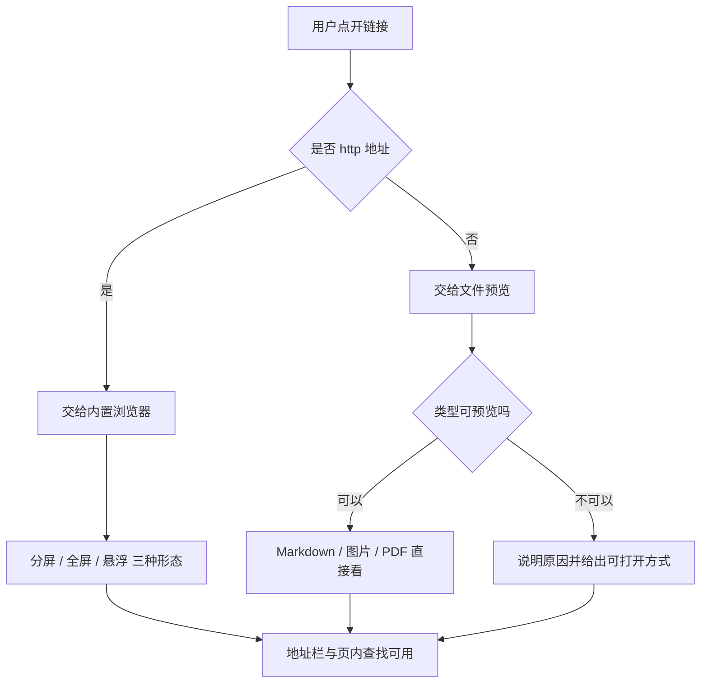

# 验收 · 交互与显示

这份文件是一张逐项验收单：每一项写清「点哪里」和「应该看到什么」。
内容按能力分类，从第 1 项往下依次点就行，不需要按顺序也没有副作用。

> 配套会话：项目 `LamTools` 下的会话「验收 · 交互与显示」。
> 那份会话目前是空的——原因写在文末「缺口说明」里，不是这次验收的功能有问题。

**怎么用**

1. 装新包，打开 Sunday。
2. 左侧 `LamTools` 项目下点开「验收 · 交互与显示」；如果只想看这份单子，也可以在文件树里打开本文件（`方案/验收-交互与显示.md`）。
3. 从上到下逐项对照「应该看到什么」打勾。

---

## 1 富文本

### 三级标题：普通文案

一级信息用列表承载，读起来比堆句子快：

- 无序列表第一项：`并行` 与 `串行` 的区别在这里不重要
- 无序列表第二项：缩进应当对齐，而不是错位半格
  - 二级缩进
- 无序列表第三项：行距正常，没有挤在一起

有序步骤：

1. 先在设置里配好 key
2. 再新建项目
3. 最后发第一句话

任务清单：

- [x] 已完成项：应当显示勾选状态且文字带弱化
- [ ] 未完成项：应当保持空框
- [ ] 再一项未完成

表格：

| 能力 | 入口 | 预期 |
| --- | --- | --- |
| 图表 | ` ```chart ` 围栏 | 可交互的 echarts 图 |
| 流程图 | ` ```mermaid ` 围栏 | 矢量流程图 |
| 外部链接 | 普通 Markdown 链接 | 进内置浏览器 |

引用：

> 引用块应当有左侧竖线与淡背景，且和正文有明显区分。
> 第二行仍然属于同一个引用。

行内代码：`core/ui/src/preview/resolve.ts` 里的 `resolvePreviewDocument` 负责决定预览形态。

代码块（带语言高亮）：

```ts
export function previewKindFor(path: string): 'markdown' | 'text' | 'image' | 'pdf' | 'none' {
  const lower = path.toLowerCase()
  if (lower.endsWith('.md')) return 'markdown'
  if (/\.(png|jpe?g|webp|gif|avif)$/.test(lower)) return 'image'
  if (lower.endsWith('.pdf')) return 'pdf'
  return lower.includes('.') ? 'text' : 'none'
}
```

**应该看到什么**

- 标题、列表、任务框、表格、引用、行内代码、代码块七种形态都有各自样式，没有退化成纯文本
- 代码块右上角有复制按钮，点了能复制
- 表格有横向分隔线，长内容不串列

---

## 2 公式

行内公式：质能关系 $E = mc^2$，以及分式 $\frac{a}{b}$ 和求和 $\sum_{i=1}^{n} i^2$。

块级公式：

$$
\int_{0}^{1} \frac{x^{2} + 1}{\sqrt{1 - x^{2}}}\, dx \;=\; \frac{\pi}{2}\left(\frac{5}{6}\right)
$$

矩阵与对齐：

$$
\begin{aligned}
\nabla \cdot \mathbf{E} &= \frac{\rho}{\varepsilon_0} \\
\nabla \times \mathbf{B} &= \mu_0 \mathbf{J} + \mu_0 \varepsilon_0 \frac{\partial \mathbf{E}}{\partial t}
\end{aligned}
$$

**应该看到什么**

- 行内公式与文字在同一行，基线对齐，没有撑高行距
- 块级公式居中、独立成段
- 公式字体是数学斜体，而不是等宽代码字体

---

## 3 图表

三张图各自可交互（悬停出提示、点击图例切换系列显隐）。

```chart
{
  "type": "bar",
  "title": "每周消息量（示例数据）",
  "unit": "条",
  "categories": ["周一", "周二", "周三", "周四", "周五", "周六", "周日"],
  "series": [
    { "name": "人发", "data": [42, 58, 61, 47, 73, 28, 19] },
    { "name": "机回", "data": [40, 62, 59, 51, 70, 31, 22] }
  ],
  "smooth": false,
  "area": false
}
```

```chart
{
  "type": "line",
  "title": "平均首字延迟（示例数据）",
  "unit": "秒",
  "categories": ["1月", "2月", "3月", "4月", "5月", "6月"],
  "series": [
    { "name": "首字延迟", "data": [2.4, 2.1, 1.8, 1.6, 1.3, 1.1] }
  ],
  "smooth": true,
  "area": true
}
```

```chart
{
  "type": "pie",
  "title": "会话类型占比（示例数据）",
  "unit": "%",
  "categories": ["日常对话", "写方案", "改代码", "查资料"],
  "series": [
    { "name": "占比", "data": [38, 27, 22, 13] }
  ],
  "smooth": false,
  "area": false
}
```

**应该看到什么**

- 三张图分别是柱状、折线（带渐变面积）、饼图，各自有标题
- 鼠标悬停出现数值提示；点击图例能隐藏或显示系列
- 图表配色跟随当前主题，切换深浅色后不会出现看不清的文字
- 图下方没有报错文字（例如「图表数据不是合法 JSON」）

---

## 4 流程图



**应该看到什么**

- 至少 4 个节点、多个分支的流程图，箭头方向正确
- 菱形判定节点与矩形普通节点形状区分明显
- 连线上的文字（是 / 否）落在线上，不重叠
- 放大窗口时图形跟着等比缩放，文字不模糊

---

## 5 交互控件

这一类只有在**会话的助手回复**里才会真正运行；在文件预览里只显示源码（这是有意的安全边界）。
下面是原始源码，验收时要看它在回复里跑起来：

```interactive-html
<div id="demo">
  <label>半径 <input id="r" type="range" min="10" max="140" value="60"> <span id="rv">60</span></label>
  <p>面积 ≈ <b id="area">11310</b> 平方像素</p>
  <div id="stage"><div id="ball"></div></div>
</div>
<style>
  #demo { font: 13px/1.6 sans-serif; color: var(--foreground, #222); }
  #stage { position: relative; height: 160px; margin-top: 8px; border: 1px dashed var(--border, #bbb); border-radius: 8px; background: var(--background, #fff); }
  #ball { position: absolute; left: 20px; top: 60px; width: 48px; height: 48px; border-radius: 50%; background: linear-gradient(135deg, #7bd3ff, #5b8cff); cursor: grab; touch-action: none; }
</style>
<script>
(function () {
  var r = document.getElementById('r'), rv = document.getElementById('rv'), area = document.getElementById('area');
  var stage = document.getElementById('stage'), ball = document.getElementById('ball');
  function paint() { rv.textContent = r.value; area.textContent = Math.round(Math.PI * r.value * r.value); }
  r.addEventListener('input', paint); paint();
  var dragging = false, dx = 0, dy = 0;
  ball.addEventListener('pointerdown', function (e) {
    dragging = true; ball.style.cursor = 'grabbing';
    var b = ball.getBoundingClientRect(); dx = e.clientX - b.left; dy = e.clientY - b.top;
    ball.setPointerCapture(e.pointerId);
  });
  ball.addEventListener('pointermove', function (e) {
    if (!dragging) return;
    var s = stage.getBoundingClientRect();
    var x = Math.max(0, Math.min(s.width - 48, e.clientX - s.left - dx));
    var y = Math.max(0, Math.min(s.height - 48, e.clientY - s.top - dy));
    ball.style.left = x + 'px'; ball.style.top = y + 'px';
  });
  ball.addEventListener('pointerup', function () { dragging = false; ball.style.cursor = 'grab'; });
})();
</script>
```

**应该看到什么**

- 拖动小球时它跟着鼠标走，不会拖出虚线框
- 拉动滑块时「半径」数字和面积同时变化
- 控件是嵌在气泡里的，不会把整页撑破或溢出

---

## 6 写作稿

:::writing{variant="social_post" title="一发就懂的更新说明"}
周末把会话里的三个小毛病一起修了：

1. 图表在深色主题下终于看得清了，之前灰字几乎融进背景。
2. 长文档预览不再卡住，翻页像翻纸一样。
3. 文件引用点开就是分屏，不用再来回切窗口。

这次没有新概念，只是把已经有的东西做顺手。更新完直接打开旧会话就能感觉到差别。
:::

**应该看到什么**

- 成稿以卡片形式出现，有标题栏
- 卡片右上角有「编辑」和「复制」两个按钮，点编辑能改字、点复制能复制全文
- 它是本地草稿，点这些按钮不会发送任何东西

---

## 7 真实文件引用

下面五个都是仓库里真实存在的文件，点名称应当直接打开预览：

- 文档：`E:/LamTools/方案/内置浏览器-01-总体方案.md`
- 代码：`E:/LamTools/core/ui/src/preview/resolve.ts`
- 图片：`E:/LamTools/core/desktop/src-tauri/tests/fixtures/ocr-known-text.png`
- PDF：`E:/LamTools/output/pdf/lamtools-technical-paper-bilingual-v0.2.6.pdf`
- 不可预览：`E:/LamTools/lam_projects/attachment-preview-lab/05-示例文档.docx`、`E:/LamTools/lam_projects/attachment-preview-lab/07-示例演示.pptx`

**应该看到什么**

- 前四个点开后进入分屏或灯箱预览：Markdown 有排版、代码有等宽字体、图片能放大、PDF 能翻页
- `.docx` / `.pptx` 不会硬塞进预览，而是明确说明类型不支持，并给出「用默认应用打开」，且不会弹出黑窗
- 文字里的路径不会变成半截链接（例如只识别到 `E:`）

---

## 8 真实地址

- 百度：https://www.baidu.com
- 哔哩哔哩：https://www.bilibili.com

**应该看到什么**

- 点击链接进入内置浏览器，而不是甩到外部 Chrome
- 内置浏览器能在分屏、全屏、悬浮三种形态之间切换，切换后页面不白屏
- 地址栏可以改地址并回车跳转；页内查找能定位到关键字
- 关掉浏览器后回到原会话，滚动位置没有丢

---

## 9 不可预览的类型

`E:/LamTools/lam_projects/attachment-preview-lab/07-示例演示.pptx` 与 `E:/LamTools/lam_projects/attachment-preview-lab/05-示例文档.docx` 属于这一类。

**应该看到什么**

- 预览区给出明确说明（这类文件不支持直接预览），而不是空白或一直转圈
- 提供「用系统默认应用打开」，点了由 PowerPoint / Word 打开
- 全程不弹出命令行黑窗

---

## 10 判定清单

| # | 项目 | 判定标准 | 结果 |
| --- | --- | --- | --- |
| 1 | 富文本 | 七种形态样式齐全、复制按钮可用 | ☐ |
| 2 | 公式 | 行内不撑行、块级居中、数学字体正确 | ☐ |
| 3 | 图表 | 三张图可交互、图例可点、跟随主题 | ☐ |
| 4 | 流程图 | 多分支形状清晰、连线文字不重叠 | ☐ |
| 5 | 交互控件 | 拖动小球、滑块联动（需在助手回复中看） | ☐ |
| 6 | 写作稿 | 卡片可编辑可复制、不外发 | ☐ |
| 7 | 文件引用 | 四种可预览、docx/pptx 给说明 | ☐ |
| 8 | 真实地址 | 进内置浏览器、三种形态切换、查找可用 | ☐ |
| 9 | 不可预览 | 说明清楚、默认应用可打开、无黑窗 | ☐ |
| 10 | 主题 | 深色/浅色下文字与图表都看得清 | ☐ |

---

## 缺口说明（为什么配套会话是空的）

这次想做成「一个会话里十条消息，挨个点」，实际卡在一个接口缺口上，如实记录：

**能做到的**
- 通过运行中实例的 REST 接口建了会话「验收 · 交互与显示」（`LamTools` 项目）
- 通过 `POST /api/core/sessions/{id}/messages` 写入助手消息，接口返回 201，回读可见

**做不到的**
- 这些消息在界面上不显示。原因是两套存储不同源：REST 写入只进会话快照里的 `messages` 字段，而聊天气泡由 `core.items`（逐条 item 投影）构建；`item_order` 为空，气泡就是空的。已核对：该会话 `messages` 有 1 条，`core_items` 0 条。
- 不触发模型运行的前提下，没有任何接口能写入 `core.items`。REST 侧没有 item 写入端点，WebSocket 侧的 item 事件只在一次真实 turn 内部产生。

**建议后端补的接口**
1. `POST /api/core/sessions/{id}/items`：接受 `{role, content, parts, metadata}`，同时写 `core.items` 行与 `item_order`，并按 `core/runItem` 广播，使已打开的客户端即时出现气泡（无需 turn）。
2. 或者在 `thread.read` / snapshot 组装时把 `messages` 投影进 `items`（一次性兼容层），让「直接写历史」至少在重开会话后可见。
3. 两者都不做的话，`POST /messages` 这种「写得进去、看不见」的接口应当显式拒绝，别让人以为成功了。

**现在的替代做法**
- 本文件在应用的 Markdown 预览里就能看到第 1～4、6～9 项的真实效果（图表、流程图、公式、文件链接、外部地址都会真的渲染）。
- 第 5 项（可交互控件）只在会话助手回复里运行，需要在会话里让我渲染一次，或把它贴进能跑 interactive-html 的回复里再验收。
